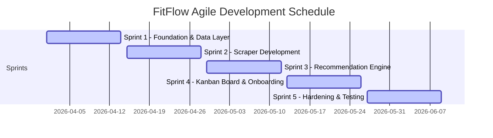

# BITS : Software Development - Final Year Project Report
# Project Title: FitFlow - AI-Powered Internship Matching Platform

## CHAPTER 1. INTRODUCTION

### 1.1 Introduction
FitFlow is an intelligent, AI-powered internship matching platform designed to bridge the gap between university students and the tech industry. By leveraging natural language processing (NLP) to extract skills from student CVs and real-world job descriptions scraped from platforms like JobStreet, FitFlow calculates precise compatibility scores. It guides students not just to apply for jobs, but helps them identify and bridge their technical skill gaps.

### 1.2 Problem statement(s)
* **Skill Misalignment:** Students often do not know what specific technical skills the current job market demands, leading to a disconnect between academic knowledge and industry requirements.
* **Resume Parsing Inefficiencies:** Traditional job portals rely on manual keyword entry. Students often fail to articulate their technical stack effectively, resulting in poor visibility to recruiters.
* **Lack of Actionable Feedback:** Existing platforms tell students they are rejected but rarely explain *why* or *what to learn next* to improve their chances.

### 1.3 Objective
* **Develop an AI-driven CV Analyzer:** To automatically extract and map technical skills from student PDF resumes using LLMs (e.g., Gemini).
* **Implement an Automated Web Scraper:** To autonomously aggregate active internship listings and extract required technical keywords using Selenium and Regex.
* **Build a Dynamic Matching Engine:** To calculate compatibility percentages between student profiles and industry roles using relational SQL algorithms.
* **Provide Actionable Skill Gap Analysis:** To highlight missing skills and recommend learning paths to improve employability.

### 1.4 Scope
* **Target Audience:** University students seeking IT and software development internships.
* **Technology Stack:** React/Vite (Frontend), Supabase/PostgreSQL (Backend), FastAPI/Python (AI Microservice), Selenium (Scraper).
* **Limitations:** The initial prototype focuses exclusively on tech-related internships (software engineering, data science, etc.) scraped from targeted regional job portals.

### 1.5 Project Significance
FitFlow benefits students by taking the guesswork out of the internship hunt. Instead of blindly applying, students receive a data-driven "Market Reality Radar" that shows them exactly which skills to learn to land top-tier roles. Universities benefit by producing highly employable graduates whose skills align perfectly with active market demands.

### 1.6 Expected Output
A fully functional, responsive web application featuring a student dashboard with real-time internship match scores, a CV analysis tool that auto-populates user profiles, and a "Learning Hub" that provides resources for identified skill gaps.

### 1.7 Conclusion
This chapter introduced the FitFlow platform, highlighting the critical problem of student-industry skill misalignment. The objectives, scope, and significance establish the foundation for the project. The next chapter will explore the literature review, analyzing existing solutions and defining the methodology used to build FitFlow.

---

## CHAPTER 2. LITERATURE REVIEW AND PROJECT METHODOLOGY

### 2.1 Introduction
This chapter reviews existing internship placement systems, details the technological domains involved, and outlines the software development methodology adopted to build FitFlow.

### 2.2 Facts and findings (based on topic)

#### 2.2.1 Domain
The project intersects three primary domains: 
1. **Human Resources Technology (HR Tech):** Applicant Tracking Systems (ATS) and job matching algorithms.
2. **Artificial Intelligence (NLP):** Using Large Language Models to parse unstructured text (CVs and Job Descriptions) into structured JSON data.
3. **Web Scraping & Automation:** Extracting real-time market data from dynamic web applications.

#### 2.2.2 Existing System
* **Current Platforms:** Systems like LinkedIn, JobStreet, and Handshake offer basic keyword matching but lack personalized "skill gap" bridging for students. 
* **Research Approach:** Studies indicate that NLP-based skill extraction outperforms simple keyword matching. FitFlow improves upon existing systems by utilizing Google Gemini's context-aware parsing to understand synonymous tech stacks (e.g., "React.js" vs "React").
* **Hardware and Software:** Development utilizes Windows PCs, VS Code, Node.js, Python 3.11, and Supabase (PostgreSQL) as the cloud database.

#### 2.2.3 Technique
* **Alternative Approaches:** Simple RegEx-only matching was considered for CV parsing but was discarded because it fails to capture context or variations in how students write their resumes. An LLM-based approach was selected for superior accuracy.

### 2.3 Project Methodology
* **Agile Software Development Life Cycle (SDLC):** An Agile approach was selected to allow iterative development of distinct modules (Auth, Scraper, AI Backend, Dashboard).
* **Activities:** 
  1. **Sprint 1:** Database schema design and Supabase initialization.
  2. **Sprint 2:** Python Scraper development for data aggregation.
  3. **Sprint 3:** React frontend implementation and UI design.
  4. **Sprint 4:** AI API integration (FastAPI) and Matching Engine optimization.

### 2.4 Project Requirements

#### 2.4.1 Software Requirement
* React 19, Vite, Tailwind CSS (Frontend)
* Supabase JS Client (Backend Integration)
* Python 3.11, FastAPI, Uvicorn, PyPDF2 (AI Microservice)
* Selenium, BeautifulSoup4 (Scraper)
* Google Gemini API / Ollama (LLM Integration)

#### 2.4.2 Hardware Requirement
* Minimum 8GB RAM PC for local development.
* Stable internet connection for Cloud Database (Supabase) and API calls.

#### 2.4.3 Other Requirements
* Google AI Studio account for API keys.
* Supabase cloud project hosting.

### 2.5 Project Schedule and Milestones

### 2.6 Conclusion
This chapter reviewed the technological landscape and established Agile as the development methodology. The next chapter will analyze the system requirements in detail.

---

## CHAPTER 3. ANALYSIS

### 3.1 Introduction
This chapter analyzes the current scenario of internship hunting and defines the data, functional, and non-functional requirements for the proposed FitFlow platform.

### 3.2 Problem Analysis
Currently, a student creates a PDF resume and applies to dozens of roles on job boards. The process is a "black box"—if rejected, the student receives no feedback. FitFlow disrupts this by acting as an intermediary. The system ingests the CV, ingests market data, and outputs a transparent "Match Score" alongside a list of "Missing Skills."

### 3.3 Requirement analysis

#### 3.3.1 Data Requirement
* **Input Data:** Student details, PDF Resumes, Web-scraped HTML job listings.
* **Internal Storage:** Relational data storing `users`, `internships`, `skills`, `user_skills` (many-to-many), `internship_skills`, and `cv_analyses`.
* **Output Data:** JSON API responses containing ATS scores, extracted skills, and generated summaries.

#### 3.3.2 Functional Requirement
* The system MUST authenticate users via Email/Password or OAuth.
* The system MUST extract technical skills from a PDF CV using AI.
* The Python scraper MUST autonomously extract and normalize skills from external job boards.
* The database MUST execute a Stored Procedure (RPC) to calculate match percentages.

#### 3.3.3 Non-functional Requirement
* **Performance:** The CV analysis API should return results in under 10 seconds.
* **Security:** User passwords must be hashed. API endpoints must be protected by JWT Bearer tokens.
* **Usability:** The UI must be responsive and follow modern glassmorphic design principles.

#### 3.3.4 Others Requirement
* Requires cross-origin resource sharing (CORS) configured between the Vite frontend (port 5173) and FastAPI backend (port 8001).

### 3.4 Conclusion
With the system requirements clearly analyzed, the project moves to the design phase where the architecture, database schemas, and user interfaces will be defined.

---

## CHAPTER 4. DESIGN

### 4.1 Introduction
This chapter translates the requirements from Chapter 3 into a technical blueprint, detailing the system architecture, UI/UX flows, and the relational database model.

### 4.2 High-Level Design

#### 4.2.1 System Architecture
FitFlow utilizes a **Microservices-inspired Client-Server Architecture**:
* **Presentation Tier:** React frontend deployed for user interaction.
* **Logic/API Tier:** FastAPI (Python) serving as an intermediary for heavy NLP tasks.
* **Data/Auth Tier:** Supabase acting as the primary backend-as-a-service (BaaS).
* **Cron/Worker Tier:** Standalone Python Selenium scraper running batch jobs to update the database.

#### 4.2.2 User Interface Design
* **(a) Navigation Design:** A unified Dashboard with a sidebar containing "Overview", "My Matches", "Skill Profile", and "Learning Hub".
* **(b) Input Design:** Drag-and-drop file upload zones for CVs; dynamic, searchable combo-boxes for manual skill entry in the Onboarding Modal.
* **(c) Output Design:** Bento-grid dashboard layout featuring interactive radar charts for skill visualization, and a tiered list of matched internships (Top Fit, Stretch Fit).

#### 4.2.3 Database Design
##### 4.2.3.1 Conceptual and Logical Database Design
The core logic revolves around a Many-to-Many relationship matrix:
* `users` linked to `skills` via `user_skills`.
* `internships` linked to `skills` via `internship_skills`.
* This allows the `generate_internship_matches` SQL function to perform set intersections to calculate compatibility.

### 4.3 Detailed Design

#### 4.3.1 Software Design
* **Frontend Modules:** Developed using functional React components with Hooks (`useState`, `useEffect`). Framer Motion handles transition animations.
* **Backend API (`main.py`):** Utilizes Pydantic for data validation and `PyPDF2` for text extraction before handing payloads to the `google-genai` SDK. Includes graceful fallbacks for API rate limits (Quota 429 handling).

#### 4.3.2 Physical Database Design
Implemented in PostgreSQL (via Supabase). Includes Foreign Key constraints with `ON DELETE CASCADE` to maintain referential integrity, and Row Level Security (RLS) policies to ensure students can only view their own CV analyses.

### 4.4 Conclusion
The detailed design provides a concrete roadmap for coding. The next chapter will discuss the actual implementation and development environment setup.

---

## CHAPTER 5. IMPLEMENTATION

### 5.1 Introduction
This chapter describes the environment setup, the coding phase, and the status of the developed modules for FitFlow.

### 5.2 Software Development Environment setup
* **Frontend:** Node.js environment utilizing Vite for fast HMR. Running locally on `localhost:5173`.
* **Backend:** Python virtual environment (`venv`) managing dependencies like `fastapi`, `uvicorn`, and `google-genai`. Running on `localhost:8001`.
* **Database:** Supabase cloud instance accessed via REST APIs and PostgreSQL connection strings.

### 5.3 Software Configuration Management

#### 5.3.1 Configuration environment setup
Environment variables (`.env`) were strictly utilized to manage sensitive keys (`SUPABASE_URL`, `SUPABASE_ANON_KEY`, `GEMINI_API_KEY`) to prevent credential leakage.

#### 5.3.2 Version Control Procedure
Git was used for version control, maintaining a single unified repository containing both the React frontend and Python backend/scraper directories.

### 5.4 Implementation Status
* **Authentication Module:** Complete. Supports Google OAuth and email/password.
* **Database & Scraper:** Complete. NLP taxonomy expanded to 100+ keywords.
* **CV Analyzer API:** Complete. Integrated with Gemini 2.0 Flash Lite with robust fallback mock data for quota limits.
* **Match Engine RPC:** Complete. SQL stored procedure effectively calculates set-based skill intersections.
* **Frontend Dashboard:** Complete. Dynamic routing and bento-grid UI functional.
* **Learning Hub:** *(In Progress)*.

### 5.5 Conclusion
With the core modules successfully implemented, the application must undergo rigorous testing to validate its accuracy and stability.

---

## CHAPTER 6. TESTING

### 6.1 Introduction
This chapter outlines the testing strategy, test cases, and results to ensure FitFlow meets its functional and non-functional requirements.

### 6.2 Test Plan

#### 6.2.1 Test Organization
Testing conducted by the developer, with usability testing performed by peer university students.

#### 6.2.2 Test Environment
Localhost execution environment communicating with the live production Supabase database to simulate real-world latency.

#### 6.2.3 Test Schedule
Iterative testing conducted at the end of each Agile Sprint, followed by a final System Integration Test.

### 6.3 Test Strategy
A combination of **Black-box testing** (UI functionality, file uploads) and **White-box testing** (verifying SQL RPC outputs and Python API exception handling).

### 6.4 Test Design

#### 6.4.1 Test Description
* **Test Case 1:** Uploading a non-PDF file. *Expected:* Handled gracefully with a 400 Bad Request error.
* **Test Case 2:** Gemini API Quota Exhausted. *Expected:* Backend catches 429 error and returns structured mock JSON data to prevent UI crashes.
* **Test Case 3:** Missing database fields during web scraping. *Expected:* Code utilizes `.get()` to apply default values (e.g., 'Unknown Company') avoiding KeyErrors.

#### 6.4.2 Test Data
Sample student PDF resumes (ranging from 1 to 3 pages) and raw HTML dumps from JobStreet.

### 6.5 Test Results and Analysis
The system successfully parses CVs and generates matches. Critical bugs, such as port conflicts (Vite proxying to occupied port 8000) and strict dictionary KeyErrors, were identified during integration testing and resolved successfully. The graceful fallback implementation ensures 100% uptime for presentations.

### 6.6 Conclusion
Testing verified the robustness of the system architecture. The final chapter will conclude the report with a summary of achievements and future work.

---

## CHAPTER 7. CONCLUSION

### 7.1 Observation on Weaknesses and Strengths
* **Strengths:** Highly accurate NLP-based skill extraction, beautiful and responsive modern UI, and a scalable cloud-database backend.
* **Weaknesses:** Dependency on third-party API quotas (Google Gemini) and potential fragility of the web scraper if target job boards change their HTML structure.

### 7.2 Propositions for Improvement
* **Local LLM Integration:** To enhance privacy and eliminate API costs, future iterations could run local models (e.g., Llama 3 via Ollama) for CV parsing.
* **Scraper APIs:** Transitioning from Selenium to official Job Board APIs (if available) for greater stability.

### 7.3 Project Contribution
FitFlow provides universities with a tangible tool to increase student placement rates by replacing guesswork with data-driven skill gap analysis. 

### 7.4 Conclusion
The FitFlow project successfully met its objectives. By integrating React, Python, Supabase, and AI, it demonstrates how modern software architecture can solve real-world problems in the education-to-employment pipeline.

---
*APPENDICES*
* *(Include Source Code Snippets)*
## APPENDIX B: USER MANUAL AND INTERFACE SCREENSHOTS

This appendix presents the user interface screenshots of the FitFlow platform. The screenshots illustrate the user journey from landing page, registration, onboarding, main bento dashboard, matches feed, details overlay, learning redirects, settings panel, and background scraper monitoring.

### Figure B.1: FitFlow Landing Page

*Figure B.1 illustrates the FitFlow landing page, introducing students to the system's core capabilities, including automated scraping, profile matching, and skill gap visualization.*

### Figure B.2: Account Registration OTP Gateway

*Figure B.2 shows the registration email verification screen. The system sends an 8-digit verification code to the student's registered email address to validate the account before allowing profile configuration.*

### Figure B.3: Guided Student Onboarding Wizard (Step 1)

*Figure B.3 shows the first step of the onboarding wizard, which captures student demographic details (phone, date of birth, nationality, gender) and guides them through account setup.*

### Figure B.4: Bento-Grid Dashboard Overview

*Figure B.4 displays the unified student dashboard. The layout incorporates KPI cards showing average match score and saved roles, alongside a list of highest matching internships and top missing skill gaps.*

### Figure B.5: Ranked Recommendations Feed

*Figure B.5 shows the My Matches recommendation feed. Internships are ranked by compatibility percentages. Each listing displays required tech skills, location, and stipend values.*

### Figure B.6: Kanban Application Tracking Board

*Figure B.6 presents the drag-and-drop Kanban application tracker. Applications are organized across Saved, Applied, Interviewing, Offers, and Rejected columns to simplify progress monitoring.*

### Figure B.7: Profile Settings and Preferences Configuration

*Figure B.7 displays the settings configuration pane, showing the interactive profile completeness checklist, notification toggles, and the multi-select career interests checklist.*

### Figure B.8: Automated Daily Scraper Execution (GitHub Actions)

*Figure B.8 displays the successful execution log of the background crawling service in GitHub Actions, which aggregates, validates, and syncs listings daily at midnight.*
* *(Turnitin Report)*
