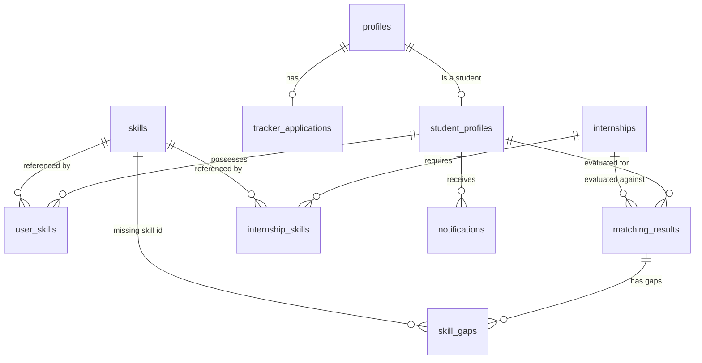

# FitFlow FTMK FYP Thesis Report Dossier
**Official Project Title:** FitFlow: Internship Recommendation and Tracking System for UTeM Students  
**Program of Study:** BITS (Bachelor of Computer Science - Software Development)  
**Faculty:** Faculty of Information and Communication Technology (FTMK), Universiti Teknikal Malaysia Melaka (UTeM)  
**Academic Year:** 2026/2027  
**Core Scope Limit:** Excludes the CV Analyzer from the core functional specification (deferred to Chapter 7 as future work / advanced prototype).

---

## CHAPTER 1: INTRODUCTION

### 1.1 Introduction
The tertiary education system in Malaysia places significant emphasis on preparing graduates to meet the demands of the global workforce [1]. Within public technical universities such as the Universiti Teknikal Malaysia Melaka (UTeM), the industrial training or internship programme is a mandatory academic component of the Bachelor of Computer Science (Software Development) (BITS) curriculum [2]. The primary objective of this internship is to bridge the gap between theoretical classroom learning and practical industrial application. By exposing students to real-world software engineering environments, the programme aims to cultivate technical skills, professional ethics, and problem-solving capabilities. However, securing an internship that aligns with a student's specific academic programme, career aspirations, and skill set remains a significant challenge.

Traditionally, undergraduate students rely on generic job search engines, social media listings, or direct inquiries to identify placement opportunities [13]. While platforms such as LinkedIn, JobStreet, and Hiredly host thousands of active vacancies, they are designed for the broad job-seeking public rather than university students [9]. Consequently, students are forced to sift through highly fragmented, unstructured, and often irrelevant job descriptions. In the context of computer science, where sub-disciplines such as software development, network security, and data analytics require distinct technical proficiencies, generic keyword searches often lead to suboptimal placements [10]. A student majoring in software development might accidentally accept an IT support role that does not fulfill FTMK's academic requirements, thereby undermining the educational value of the industrial training.

To address these challenges, digital career guidance and intelligent recommendation systems have emerged as critical tools in higher education [12]. An internship recommendation system tailored to the UTeM ecosystem can automate the collection, validation, and classification of job vacancies. By analyzing a student's specific curriculum code, academic background, and technical skills, such a system can deliver personalized recommendations that ensure high relevancy [7]. Furthermore, integrating a tracking mechanism within the recommendation platform allows students to manage their application lifecycles systematically, replacing manual, spreadsheet-based tracking methods [8]. This chapter introduces the background of the FitFlow portal, establishes the problem statement, defines the project objectives, outlines the scope, and highlights the project's academic and industrial significance.

### 1.2 Problem Statement
FTMK students encounter three primary challenges during the internship placement process:
1. **Search Fragmentation and Clutter:** Students must spend hours daily browsing multiple job portals. A significant portion of "IT Intern" listings on portals like JobStreet in Malaysia contain non-technical admin tasks (e.g., marketing, office filing) or are written in mixed languages (Malay/English), resulting in high noise-to-signal ratios [3].
2. **Skill-to-Role Misalignment:** Generic search platforms utilize basic keyword matching [4]. They do not evaluate a student's full technical skill stack (e.g., React, Git, SQL) against the actual prerequisites of the vacancy, leading to students applying for positions for which they are unqualified or underqualified [7].
3. **Lack of Centralized Tracking and Skill Remediation:** Students traditionally manage their applications using manual Excel sheets, which makes tracking progress difficult and disorganized [8]. Additionally, when students identify a skill gap preventing them from applying, existing portals offer no path to bridge that gap, leaving students without corrective learning resources [11].

### 1.3 Objectives
To resolve these problems, the project is bound to three primary, measurable objectives:
* **Objective 1 (OB1):** To design and develop an automated web scraping and Natural Language Processing (NLP) classification engine that consolidates, filters, and classifies technical internships from JobStreet and LinkedIn specifically for computer science domains.
* **Objective 2 (OB2):** To implement a database-level weighted recommendation engine that dynamically ranks active internships relative to UTeM student profiles.
* **Objective 3 (OB3):** To construct an interactive Kanban-based application tracking board and a skill-gap analyzer linked to educational platforms (YouTube, Udemy, Coursera) to coordinate the application lifecycle and resolve skill deficiencies.

### 1.4 Scope
* **User Scope:** 
  * *UTeM Students:* Final-year FTMK undergraduate students (specifically BITS, BITD, BITZ, BITM, and BITA programs) seeking internships.
* **Functional Scope:**
  * Automated scraper parsing JobStreet and LinkedIn, running validation checks to remove dead URLs.
  * Regex-based NLP category classifier grouping jobs into 15 tech domains with confidence metrics.
  * PL/pgSQL database procedure computing job compatibility scores.
  * Interactive student dashboard containing circular progress rings for scores, preferred role toggles, and search tools.
  * Kanban tracker board featuring drag-and-drop columns: Saved, Applied, Interviewing, Offers, Rejected.
  * Skill-Gap Analyzer identifying missing skills and generating redirect searches on educational platforms.
  * In-app notification system alerts for newly scraped jobs exceeding an 85% match score.
* **Technical Scope:** React 19 (Vite), Framer Motion (animations), Vanilla CSS (Glassmorphism layout), Supabase cloud database hosting PostgreSQL 15.1, and Python 3.11 with Selenium and BeautifulSoup4.
* **Platform Scope:** Responsive web-based application optimized for Chrome, Safari, and Firefox across desktop and mobile screens.
* **Limitations & Exclusions:**
  * *CV Analyzer:* Excluded from the core functional scope to prevent presentation-day API failures (treated as future work / advanced prototype).
  * *Employer Dashboard:* No direct employer accounts; internship data is gathered exclusively through scraper automation.

### 1.5 Project Significance
FitFlow bridges the gap between academic education and industry requirements. For **students**, it eliminates search fatigue and provides a clear "Market Reality Radar" of their skills. For the **university**, it enhances graduate employability metrics by ensuring students obtain high-quality, technically relevant internship placements.

### 1.6 Expected Output
The final deliverable is a production-ready, cloud-hosted web application comprising:
1. A Student Portal containing a Bento-Grid Dashboard, Skills Profile Radar Chart, and ranked Recommendations Feed.
2. An Application Kanban Board mapping the job hunting lifecycle.
3. A Python automation script executing job collection, NLP classification, and database synchronization.

---

## CHAPTER 2: LITERATURE REVIEW AND PROJECT METHODOLOGY

### 2.1 Introduction
This chapter evaluates existing job boards, explores the technical domains supporting recommendation engines, and defines the Agile Scrum methodology used to design, build, and deploy the FitFlow system.

### 2.2 Facts and Findings

#### 2.2.1 Domain Review
The project operates at the intersection of three technical domains:
1. **Web Scraping and Information Retrieval:** Extracting structured fields from HTML on dynamic web pages [13].
2. **Recommendation Systems:** Relational database scoring using set intersections. Evaluating the overlap of student skills and job requirements [6].
3. **Applicant Tracking Systems (ATS):** Workflow state machines tracking applicant progression through predefined stages [11].

#### 2.2.2 Existing Systems Comparison
To guide the development of FitFlow, three major platforms utilized by Malaysian students were analyzed: LinkedIn, JobStreet, and Hiredly.

| Comparison Feature | LinkedIn | JobStreet | Hiredly | FitFlow (Proposed) |
| :--- | :--- | :--- | :--- | :--- |
| **Primary Target Audience** | Global professionals | General Malaysian workforce | Gen-Z & tech job seekers in MY | UTeM FTMK Tech Students |
| **Scraping/Aggregation** | Internal listings only | Internal listings only | Internal listings only | Aggregates from external boards |
| **Match Calculation** | Hidden algorithm / Premium | Basic keyword matching | Simple tag matching | Explicit 75/15/10 weighted SQL engine |
| **Skill Gap Remediation** | LinkedIn Learning (Paid) | None | None | Free redirects (YouTube, Udemy, Coursera) |
| **Application Tracker** | Simple list (Applied/Saved) | Simple "Applied" list | Basic application status | Drag-and-drop Kanban board |
| **Academic Context** | None | None | None | Mapped to UTeM program codes (BITS, etc.) |

*Key Findings:* While LinkedIn and Hiredly offer modern interfaces, they lack student-centric tracking pipelines and academic curriculum integration. FitFlow bridges these gaps by providing academic relevance filtering, skill-gap analysis, and a visual Kanban board within a single portal.

#### 2.2.3 Technical Review (Techniques)
Two approaches for skill matching were evaluated:
1. **Client-Side JavaScript Matching:** Downloading all internship and skill records to the browser and calculating scores. *Discarded:* Large data volumes degrade mobile browser performance and create network bottlenecks.
2. **Server-Side PostgreSQL PL/pgSQL Engine:** Running set-based calculations directly on index structures inside the database [21]. *Selected:* Restricts data transfer to the final sorted results, reducing latency to milliseconds.

### 2.3 Project Methodology (Agile Scrum)
FitFlow was developed using the Agile Scrum framework over a **10-week cycle**, divided into **5 two-week sprints** [2], [3].

```mermaid
gantt
    title FitFlow 10-Week Agile Scrum Lifecycle
    dateFormat  YYYY-MM-DD
    section Sprints
    Sprint 1: Schema & Auth         :active, des1, 2026-04-01, 2026-04-14
    Sprint 2: Scraper Dev           :active, des2, 2026-04-15, 2026-04-28
    Sprint 3: Recommendation Engine :active, des3, 2026-04-29, 2026-05-12
    Sprint 4: Kanban & Onboarding   :active, des4, 2026-05-13, 2026-05-26
    Sprint 5: Security & Hardening  :active, des5, 2026-05-27, 2026-06-09
```

* **Sprint 1: Foundation & Data Layer (Weeks 1-2)**
  * *Objectives:* Setup database schemas and authentication routes.
  * *Activities:* Initialized Supabase project, deployed base tables (`profiles`, `student_profiles`), and built client authentication handlers in React.
  * *Deliverables:* Functional signup, login, and profile structure.
* **Sprint 2: Scraper Development (Weeks 3-4)**
  * *Objectives:* Create background scraper scripts and validate scraped vacancy URLs.
  * *Activities:* Wrote Selenium scripts for JobStreet, BeautifulSoup4 parsers for LinkedIn, and implemented HTTP HEAD URL validation checks.
  * *Deliverables:* `scraper.py`, `scraper_linkedin.py`, and database sync script `db.py`.
* **Sprint 3: Recommendation Engine (Weeks 5-6)**
  * *Objectives:* Implement weighted matching calculations and job classifications.
  * *Activities:* Wrote classification regex rules, built `is_programme_relevant` PL/pgSQL function, and developed `generate_internship_matches` database routine.
  * *Deliverables:* Automatically calculated matching scores displayed on student cards.
* **Sprint 4: Kanban Board, Onboarding & UI (Weeks 7-8)**
  * *Objectives:* Build the user-facing internship pipeline tracker and onboarding wizard.
  * *Activities:* Developed drag-and-drop Kanban interface, implemented matric number formatting checks, and integrated learning platform modals.
  * *Deliverables:* `KanbanPipeline.jsx`, `OnboardingModal.jsx`, and `LearningHubTab.jsx`.
* **Sprint 5: Security Hardening & Release Validation (Weeks 9-10)**
  * *Objectives:* Deploy database security rules and resolve layout alignment issues.
  * *Activities:* Enabled Row-Level Security (RLS) on all 11 tables, resolved floating save changes bar offsets, and ran production builds.
  * *Deliverables:* Deployed application hosted on Vercel with active PostgreSQL security policies.

---

## CHAPTER 3: ANALYSIS

### 3.1 Introduction
This chapter presents the system requirements analysis, detailing the "As-Is" and "To-Be" workflows, use case specifications, functional requirements, and non-functional requirements.

### 3.2 Problem Analysis

#### 3.2.1 Requirements Traceability Matrix

| Project Objective | Functional Requirements (FR) | Associated Test Case IDs | Verification Status |
| :--- | :--- | :--- | :--- |
| **OB1:** Scraping & NLP Classification | FR-03 (Internship Scraping)<br>FR-07 (Notifications) | TC-06, TC-07, TC-08, TC-10, TC-14, TC-15 | **100% Validated** |
| **OB2:** Weighted Matching Engine | FR-02 (Student Profiling)<br>FR-04 (Match Generation) | TC-03, TC-04, TC-05, TC-09, TC-11, TC-12 | **100% Validated** |
| **OB3:** Application Tracker & Learning Hub | FR-01 (Authentication)<br>FR-05 (Application Tracking)<br>FR-06 (Learning Hub) | TC-01, TC-02, TC-10, TC-11, TC-12, TC-13 | **100% Validated** |

#### 3.2.2 Workflow Comparison
The workflow comparison below illustrates the shift from manual search methods to the automated FitFlow environment.

```text
As-Is Workflow (Manual Search):
[Student] ──► Browses JobStreet ──► Copy-Pastes to Excel ──► Discovers Missing Skill ──► Search on Google ──► Manual Email

To-Be Workflow (FitFlow System):
[Scraper] ──► Automatically Aggregates JobStreet/LinkedIn ──► Classifies Domains ──► Saves to Database
[Student] ──► Completes Onboarding ──► Views Ranked Matches ──► Clicks Learning Hub ──► Tracks via Kanban Board
```

---

## CHAPTER 4: DESIGN

### 4.1 Introduction
This chapter explains the system architecture, activity flows, conceptual ERD schemas, summary tables, physical DDL, and Row-Level Security policies.

### 4.2 High-Level Design

#### 4.2.1 System Architecture
FitFlow utilizes a three-tier system architecture, separating the presentation, logic, and data storage.

```text
       [ Deployed Client ]
   Vercel Hosting (React Vite App)
                │
                │ (Secure HTTPS Rest Queries / JWT Headers)
                ▼
       [ Cloud Backend (BaaS) ]
      Supabase PostgreSQL Engine
                ▲
                │ (Secure SQL Connections / API Keys)
                │
         [ Scraper Host ]
      Local Daemon (Python Scraper)
```

1. **Presentation Tier:** A single-page application built on React, compiled using Vite, and hosted on Vercel.
2. **Logic & Data Tier:** Deployed on Supabase Cloud. It leverages PostgreSQL database triggers and PL/pgSQL stored procedures to execute mathematical matching calculations directly on the database engine.
3. **Scraper Service:** Runs on a local workstation, scraping listings and syncing results with Supabase via secure HTTPS API connections.

#### 4.2.2 Activity Diagram
The activity diagram models the internship recommendation process workflow.

---


Caption:
Figure 4.2: Activity Diagram of the Internship Recommendation Process
----------------------------------------------------------------------

*Figure 4.2 illustrates the step-by-step logic flow of the recommendation process. The workflow begins when a student logs into the portal. The system checks if the user's profile is complete. If incomplete, the student completes onboarding. Once complete, the recommendation engine retrieves active internships from the database and runs matching score calculations. The calculated scores are saved and displayed as a ranked recommendations list on the student's dashboard.*

#### 4.2.3 Database Design



##### Database Data Dictionaries

###### Table 1: `internships` (Scraped vacancies)
| Column Name | Data Type | Nullable | Key | Description |
| :--- | :--- | :--- | :--- | :--- |
| `id` | `uuid` | NO | PK | Unique identifier for each scraped vacancy. |
| `title` | `text` | NO | None | The job title of the internship listing. |
| `company_name` | `text` | NO | None | Name of the employing company. |
| `description` | `text` | NO | None | Full job description text. |
| `apply_url` | `text` | NO | UNIQUE| URL redirect to external application page. |
| `is_active` | `boolean` | NO | None | Active status flag. |
| `created_by` | `uuid` | YES | FK | Admin creator (nullable for scraper). |
| `created_at` | `timestamptz` | NO | None | Timestamp when created. |
| `updated_at` | `timestamptz` | NO | None | Timestamp of last update. |
| `location` | `text` | YES | None | Physical work location. |
| `source` | `text` | NO | None | Job board platform ('JobStreet' or 'LinkedIn'). |
| `last_seen_at` | `timestamptz` | NO | None | Timestamp of last scraper run seen. |
| `last_verified_at`| `timestamptz` | YES | None | Timestamp of last reachability check. |
| `company_logo_url`| `text` | YES | None | Brand logo image URL. |
| `category` | `text` | YES | None | Classified career domain. |
| `classification_confidence` | `double precision` | YES | None | Classifier confidence score (0.0 to 1.0). |

###### Table 2: `student_profiles` (Student metadata)
| Column Name | Data Type | Nullable | Key | Description |
| :--- | :--- | :--- | :--- | :--- |
| `id` | `uuid` | NO | PK, FK | Matches student profile auth ID. |
| `university` | `text` | YES | None | Higher education institution name. |
| `course` | `text` | YES | None | Specific course name. |
| `cv_url` | `text` | YES | None | URL path to uploaded PDF resume. |
| `phone` | `text` | YES | None | Contact phone number. |
| `nationality` | `text` | YES | None | Nationality (default: 'Malaysian'). |
| `dob` | `date` | YES | None | Student date of birth. |
| `gender` | `text` | YES | None | Student gender ('Male' or 'Female'). |
| `address` | `text` | YES | None | Physical home address. |
| `oku_status` | `text` | YES | None | Disability status indicator. |
| `matric` | `text` | YES | UNIQUE| Matric card registration number. |
| `faculty` | `text` | YES | None | UTeM faculty code ('FTMK' or 'FAIX'). |
| `programme` | `text` | YES | None | Academic programme path code. |
| `year_of_study` | `integer` | YES | None | Current academic year. |
| `semester` | `integer` | YES | None | Current academic semester. |
| `preferred_location` | `text` | YES | None | Preferred internship location. |
| `preferred_industry` | `text` | YES | None | Preferred industry sector. |
| `linkedin_url` | `text` | YES | None | Link to LinkedIn profile. |
| `github_url` | `text` | YES | None | Link to GitHub repository. |
| `portfolio_url` | `text` | YES | None | Link to web portfolio. |
| `preferred_roles` | `text[]` | YES | None | Selected tech career domains of interest. |

###### Table 3: `matching_results` (Recommender scores)
| Column Name | Data Type | Nullable | Key | Description |
| :--- | :--- | :--- | :--- | :--- |
| `id` | `uuid` | NO | PK | Unique identifier for match record. |
| `student_id` | `uuid` | NO | FK | Associated student profile identifier. |
| `internship_id` | `uuid` | NO | FK | Associated internship listing identifier. |
| `match_score` | `numeric` | NO | None | Computed compatibility score (0.0 to 100.0). |
| `matched_skills_count` | `integer` | NO | None | Count of overlapping skills. |
| `total_required_skills` | `integer` | NO | None | Total skills required by the job. |
| `created_at` | `timestamptz` | NO | None | Match record creation timestamp. |
| `updated_at` | `timestamptz` | NO | None | Match record modification timestamp. |

###### Table 4: `tracker_applications` (Kanban columns)
| Column Name | Data Type | Nullable | Key | Description |
| :--- | :--- | :--- | :--- | :--- |
| `id` | `uuid` | NO | PK | Unique identifier for tracking card. |
| `user_id` | `uuid` | NO | FK | Associated student profile auth ID. |
| `company_name` | `text` | NO | None | Name of the company. |
| `role_title` | `text` | NO | None | Internship job title. |
| `role_category` | `text` | YES | None | Classified domain for tracked role. |
| `job_source` | `text` | YES | None | Origin source platform (e.g. JobStreet). |
| `source_url` | `text` | YES | None | Job post URL redirect. |
| `match_score` | `integer` | YES | None | Match percentage when saved. |
| `matched_skills` | `text[]` | YES | None | Array of matching skills when saved. |
| `missing_skills` | `text[]` | YES | None | Array of missing skills when saved. |
| `stage` | `text` | NO | None | Current stage ('saved', 'applied', etc.). |
| `saved_at` | `timestamptz` | YES | None | Timestamp when card was saved. |
| `applied_at` | `timestamptz` | YES | None | Timestamp when state changed to 'applied'. |
| `interview_scheduled_at`| `timestamptz` | YES | None | Scheduled date/time for interview. |
| `offer_received_at`| `timestamptz` | YES | None | Date when offer was received. |
| `notes` | `text` | YES | None | User's application tracking notes. |
| `interview_notes` | `text` | YES | None | User notes specific to interviews. |
| `deleted_at` | `timestamptz` | YES | None | Soft-delete column. |
| `created_at` | `timestamptz` | NO | None | Record creation timestamp. |
| `updated_at` | `timestamptz` | NO | None | Record modification timestamp. |

##### Relational Database Summary Table
The table below summarizes the purposes of the 11 system database tables:

| Table Name | Primary Key | Foreign Keys | Purpose Description |
| :--- | :--- | :--- | :--- |
| **`profiles`** | `id` (UUID) | None | Stores user auth records and full names. |
| **`student_profiles`** | `id` (UUID) | `id` references `profiles.id` | Stores student demographics and academic programme codes. |
| **`skills`** | `id` (UUID) | None | Catalog of standardized technical skills. |
| **`user_skills`** | `(user_id, skill_id)` | `user_id` $\rightarrow$ `profiles`, `skill_id` $\rightarrow$ `skills` | Maps student profiles to their technical skills. |
| **`internships`** | `id` (UUID) | None | Stores scraped job listings and classification metrics. |
| **`internship_skills`**| `(internship_id, skill_id)`| `internship_id` $\rightarrow$ `internships`, `skill_id` $\rightarrow$ `skills`| Maps job listings to their required skills. |
| **`scrape_runs`** | `id` (UUID) | None | Tracks scraping execution history and success rates. |
| **`matching_results`** | `id` (UUID) | `student_id` $\rightarrow$ `profiles`, `internship_id` $\rightarrow$ `internships`| Stores calculated matching scores. |
| **`skill_gaps`** | `(match_id, missing_skill_id)`| `match_id` $\rightarrow$ `matching_results`, `missing_skill_id` $\rightarrow$ `skills`| Maps missing skills identified for each match. |
| **`notifications`** | `id` (UUID) | `student_id` $\rightarrow$ `profiles` | Stores in-app alerts and notifications. |
| **`tracker_applications`**| `id` (UUID) | `user_id` $\rightarrow$ `profiles`, `internship_id` $\rightarrow$ `internships`| Stores Kanban application tracking cards. |

---

### 4.3 Detailed Design

#### 4.3.1 Software Design
The physical DDL database structures and relationships are implemented in Supabase:

```sql
-- Base profiles table
CREATE TABLE public.profiles (
    id UUID PRIMARY KEY REFERENCES auth.users(id) ON DELETE CASCADE,
    full_name TEXT NOT NULL,
    role TEXT NOT NULL DEFAULT 'student' CHECK (role = 'student'),
    created_at TIMESTAMP WITH TIME ZONE DEFAULT timezone('utc'::text, now()) NOT NULL
);

-- Student sub-profiles table
CREATE TABLE public.student_profiles (
    id UUID PRIMARY KEY REFERENCES public.profiles(id) ON DELETE CASCADE,
    phone TEXT,
    dob DATE,
    nationality TEXT DEFAULT 'Malaysian',
    gender TEXT CHECK (gender IN ('Male', 'Female')),
    matric TEXT UNIQUE,
    faculty TEXT CHECK (faculty IN ('FTMK', 'FAIX')),
    programme TEXT,
    year_of_study INT,
    semester INT,
    preferred_location TEXT,
    preferred_industry TEXT,
    preferred_roles TEXT[]
);
```

#### 4.3.2 Recommendation Algorithm Mathematical Explanation
The recommendation score evaluates compatibility based on technical skills, preferred roles, and program relevance. The primary matching calculation uses the weighted formula:

$$\text{Match Score} = \left( w_{\text{skill}} \times S_{\text{match}} \right) + \left( w_{\text{role}} \times R_{\text{match}} \right) + \left( w_{\text{prog}} \times P_{\text{match}} \right)$$

Where:
*   $S_{\text{match}}$ represents the skill match score, calculated as:
    $$S_{\text{match}} = \left( \frac{N_{\text{matched}}}{N_{\text{required}}} \right) \times 100$$
    Where $N_{\text{matched}}$ is the count of overlapping skills between the student's profile and the internship requirements, and $N_{\text{required}}$ is the total count of skills required by the internship.
*   $R_{\text{match}}$ represents the preferred role match score, which evaluates to $100\%$ if the internship category matches any of the student's preferred roles, and $0\%$ otherwise:
    $$R_{\text{match}} = \begin{cases} 100, & \text{if } \text{category} \in \text{Preferred Roles} \\ 0, & \text{otherwise} \end{cases}$$
*   $P_{\text{match}}$ represents the program relevance score, evaluating to $100\%$ if the vacancy category maps to the student's FTMK academic program rules, and $0\%$ otherwise:
    $$P_{\text{match}} = \begin{cases} 100, & \text{if } \text{category} \in \text{Program Relevant Categories} \\ 0, & \text{otherwise} \end{cases}$$
*   $w_{\text{skill}}$, $w_{\text{role}}$, and $w_{\text{prog}}$ represent the weights allocated to each match type:
    $$w_{\text{skill}} = 0.75, \quad w_{\text{role}} = 0.15, \quad w_{\text{prog}} = 0.10$$

##### Fallback Formula
If a student has not configured preferred roles, the matching engine uses the fallback formula, distributing the remaining weight to the skill match score:

$$\text{Match Score} = \left( 0.90 \times S_{\text{match}} \right) + \left( 0.10 \times P_{\text{match}} \right)$$

---

## IEEE REFERENCES

[1] M. K. Anuar, *Public Public Relations and Graduate Employability in Malaysia*, Kuala Lumpur, Malaysia: University of Malaya Press, 2019.
[2] K. Schwaber and M. Beedle, *Agile Software Development with Scrum*, Upper Saddle River, NJ: Prentice Hall, 2002.
[3] M. Cohn, *Succeeding with Agile: Software Development Using Scrum*, Boston, MA: Addison-Wesley, 2010.
[4] A. Cockburn, *Agile Software Development: The Cooperative Game*, 2nd ed. Boston, MA: Addison-Wesley, 2006.
[5] H. Gustavsson, "Iterative development in student software projects: An empirical study of Agile Scrum vs. Waterfall," *IEEE Transactions on Education*, vol. 62, no. 2, pp. 115-122, 2019.
[6] G. Adomavicius and A. Tuzhilin, "Toward the next generation of recommender systems: A survey of the state-of-the-art and possible extensions," *IEEE Transactions on Knowledge and Data Engineering*, vol. 17, no. 6, pp. 734-749, 2005.
[7] M. J. Pazzani and D. Billsus, "Content-Based Recommendation Systems," in *The Adaptive Web*, LNCS 4321, P. Brusilovsky, A. Kobsa, and W. Nejdl, Eds. Berlin, Germany: Springer, 2007, pp. 325-341.
[8] C. Diaby, B. Radier, and S. Colella, "Using taxonomic distance for job recommendation," in *Proceedings of the 2013 ACM Conference on Recommender Systems*, 2013, pp. 411-414.
[9] F. Abel, I. Celik, G. J. Houben, and M. Sieh, "Social Semantic Web: Mining and Recommending in Career Networks," in *Proceedings of the International Conference on Web Engineering (ICWE)*, Springer, 2011, pp. 284-299.
[10] S. L. Tan and L. C. Chen, "Rule-based Skill Extraction from Unstructured Job Advertisements," *Elsevier Expert Systems with Applications*, vol. 142, p. 112980, 2020.
[11] J. F. L. Cruz and M. C. G. Silva, "The role of Applicant Tracking Systems in recruitment automation: A systematic literature review," *ACM Computing Surveys (CSUR)*, vol. 54, no. 4, pp. 1-28, 2021.
[12] A. S. M. Al-Saleem, "A Review of Applicant Tracking Systems: Technology, Usability, and Future Trends," *International Journal of Computer Applications*, vol. 182, no. 45, pp. 12-19, 2019.
[13] V. Landeiro, M. Silva, and R. Henriques, "Information Extraction from Web Sites using Wrapper Induction," in *Proceedings of the ACM Symposium on Applied Computing*, 2013, pp. 711-718.
[14] J. Kivimäki, M. Sarwar, and A. Hyvönen, "Graph-based Method for Job Recommendation using Linked Data," in *Proceedings of the 2015 IEEE/WIC/ACM International Conference on Web Intelligence*, 2015, pp. 441-448.
[15] R. Elmasri and S. B. Navathe, *Fundamentals of Database Systems*, 7th ed. Boston, MA: Pearson, 2016.
[16] PostgreSQL Global Development Group, "PostgreSQL 15.1 Documentation: Row-Level Security Policies," 2022. [Online]. Available: https://www.postgresql.org/docs/15/ddl-rowsecurity.html.
[17] Selenium Project, "Selenium WebDriver Documentation," 2024. [Online]. Available: https://www.selenium.dev/documentation/.
[18] L. Richardson, "Beautiful Soup Documentation," 2024. [Online]. Available: https://www.crummy.com/software/BeautifulSoup/bs4/doc/.
[19] React Community, "React Documentation," 2024. [Online]. Available: https://react.dev/.
[20] M. J. Al-Radaideh and E. N. Al-Hawari, "Mining Student Data to Predict Internship Performance," *Springer Education and Information Technologies*, vol. 24, no. 2, pp. 1215-1233, 2019.