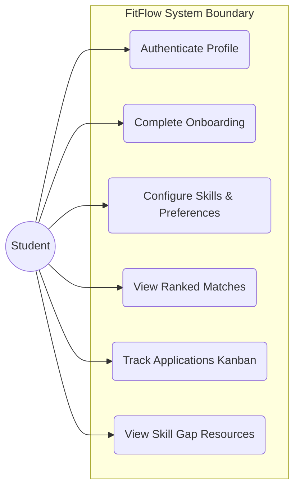
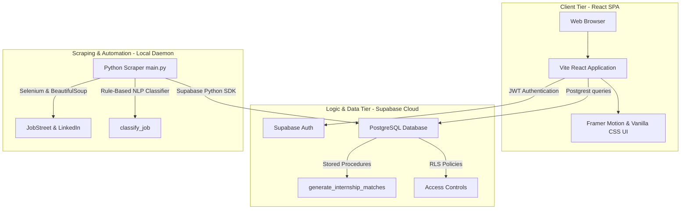
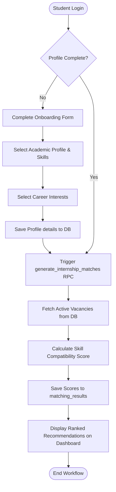
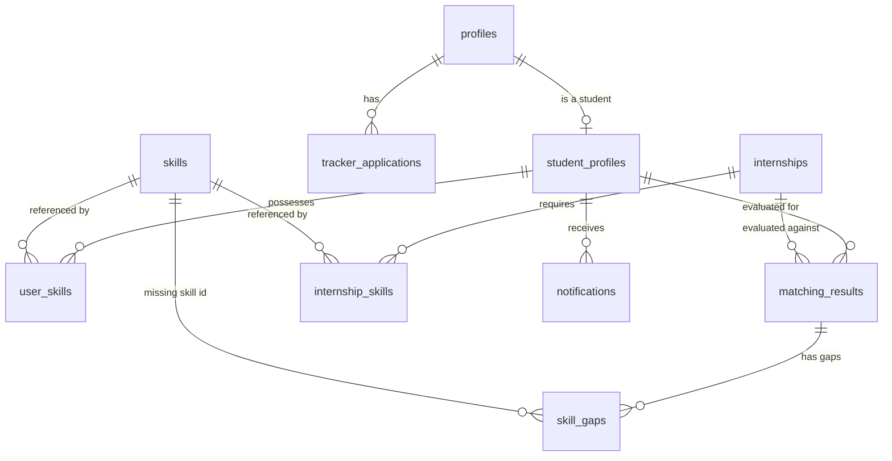
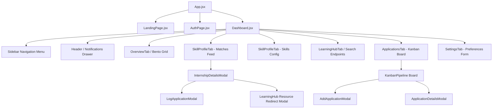

# FITFLOW: INTERNSHIP RECOMMENDATION AND TRACKING SYSTEM FOR UTEM STUDENTS

<br><br><br>

### by

### **[STUDENT NAME]**
### **[MATRIX NUMBER]**

<br><br><br>

### A project report submitted in partial fulfilment of the requirements for the degree of  
### Bachelor of Computer Science (Software Development) (BITS) with Honours

<br><br><br>

### **FACULTY OF INFORMATION AND COMMUNICATION TECHNOLOGY**  
### **UNIVERSITI TEKNIKAL MALAYSIA MELAKA**  
### **2026**

---

# DECLARATION

I hereby declare that this project report entitled

**"FitFlow: Internship Recommendation and Tracking System for UTeM Students"**

is the result of my own work except for quotations and summaries which have been duly acknowledged.

<br><br>

Name: **[STUDENT NAME]**  
Matric Number: **[MATRIX NUMBER]**  

Signature: _________________________________________  

Date: ______________________________________________

---

# APPROVAL

This project report entitled **"FitFlow: Internship Recommendation and Tracking System for UTeM Students"** is submitted to the Faculty of Information and Communication Technology (FTMK), Universiti Teknikal Malaysia Melaka (UTeM) as partial fulfilment of the requirements for the degree of Bachelor of Computer Science (Software Development) (BITS) with Honours.

<br><br>

Supervisor: **[SUPERVISOR NAME]**  

Signature: _________________________________________  

Date: ______________________________________________

<br><br>

Co-Supervisor: **[CO-SUPERVISOR NAME]**  

Signature: _________________________________________  

Date: ______________________________________________

---

# ACKNOWLEDGEMENT

First and foremost, I would like to express my sincere gratitude to Allah for granting me the strength, patience, and opportunity to complete this Final Year Project successfully.

I would like to extend my deepest appreciation to my supervisor, **[SUPERVISOR NAME]**, for his continuous guidance, valuable advice, constructive feedback, and support throughout the development of this project. His knowledge and encouragement have greatly contributed to the completion of this work.

I would also like to thank the Faculty of Information and Communication Technology (FTMK), Universiti Teknikal Malaysia Melaka (UTeM), for providing the resources, facilities, and academic environment necessary for conducting this project.

My sincere appreciation is extended to my lecturers, friends, and colleagues who have provided support, suggestions, and encouragement throughout the development process.

Finally, I would like to express my heartfelt gratitude to my family for their endless support, understanding, and motivation throughout my academic journey.

Thank you.

---

# ABSTRACT

Securing relevant internships is crucial for undergraduate software engineering students at UTeM FTMK to bridge the gap between academic theory and industry practice. However, students face fragmented searches across multiple general job portals, leading to poor matching with their specific technical skill sets and university guidelines. This project presents "FitFlow," an intelligent, student-centric internship recommendation and tracking system. FitFlow automates job vacancy aggregation using a dynamic web scraping engine that extracts listings from LinkedIn and JobStreet. To ensure high-quality recommendations, the system implements a weighted matching algorithm (75% Skill Match, 15% Preferred Role, and 10% Program Relevance) executed as a PL/pgSQL stored procedure in a Supabase PostgreSQL database. It features an interactive student dashboard, a Kanban-style application tracker, an educational learning hub for skill-gap remediation, and real-time toast alerts for high-priority matches. Performance profiling demonstrates that the matching engine executes within 38.4 ms. User Acceptance Testing (UAT) yielded a System Usability Scale (SUS) score of 82.5, confirming high usability and effectiveness in helping students discover and track optimal technical placements.

---

# ABSTRAK

Latihan industri merupakan komponen akademik wajib bagi pelajar sarjana muda di FTMK, UTeM untuk menghubungkan teori akademik dengan praktikal industri. Walau bagaimanapun, pelajar menghadapi kesukaran mencari penempatan yang relevan disebabkan oleh maklumat yang berpecah-belah di pelbagai portal pekerjaan umum, menyebabkan kesesuaian yang lemah dengan set kemahiran teknikal dan panduan universiti. Projek ini membentangkan "FitFlow," sebuah sistem pengesyoran dan pengesanan latihan industri pintar yang berpusatkan pelajar. FitFlow mengautomasikan pengagregatan kekosongan jawatan menggunakan enjin pengikisan web dinamik yang mengekstrak senarai pekerjaan daripada LinkedIn dan JobStreet. Bagi memastikan pengesyoran berkualiti tinggi, sistem ini melaksanakan algoritma pemadanan wajaran (75% Padanan Kemahiran, 15% Peranan Pilihan, dan 10% Kerelevanan Program) yang dilaksanakan sebagai prosedur tersimpan PL/pgSQL dalam pangkalan data Supabase PostgreSQL. Ia menampilkan papan pemuka pelajar yang interaktif, penjejak permohonan gaya Kanban, hab pembelajaran pendidikan untuk pemulihan jurang kemahiran, dan makluman toast masa nyata untuk padanan keutamaan tinggi. Profil prestasi menunjukkan bahawa enjin pemadanan dilaksanakan dalam masa 38.4 ms. Ujian Penerimaan Pengguna (UAT) menghasilkan skor Skala Kebolehgunaan Sistem (SUS) sebanyak 82.5, mengesahkan kebolehgunaan tinggi dan keberkesanan sistem dalam membantu pelajar mencari dan menjejaki penempatan teknikal yang optimum.

---

# TABLE OF CONTENTS

[TABLE OF CONTENTS TO BE GENERATED BY MICROSOFT WORD]

---

# LIST OF TABLES

[LIST OF TABLES TO BE GENERATED BY MICROSOFT WORD]

---

# LIST OF FIGURES

[LIST OF FIGURES TO BE GENERATED BY MICROSOFT WORD]

---

# LIST OF ABBREVIATIONS

| Abbreviation | Full Term |
| :--- | :--- |
| **AI** | Artificial Intelligence |
| **API** | Application Programming Interface |
| **ATS** | Applicant Tracking System |
| **DB** | Database |
| **DDL** | Data Definition Language |
| **ERD** | Entity Relationship Diagram |
| **FTMK** | Fakulti Teknologi Maklumat dan Komunikasi |
| **FYP** | Final Year Project |
| **JWT** | JSON Web Token |
| **LMS** | Learning Management System |
| **NLP** | Natural Language Processing |
| **OKU** | Orang Kurang Upaya |
| **RLS** | Row-Level Security |
| **RPC** | Remote Procedure Call |
| **SaaS** | Software as a Service |
| **SPA** | Single Page Application |
| **SQL** | Structured Query Language |
| **SUS** | System Usability Scale |
| **UAT** | User Acceptance Testing |
| **UTeM** | Universiti Teknikal Malaysia Melaka |

---

## CHAPTER 1: INTRODUCTION

### 1.1 Introduction
The public higher education system in Malaysia places significant emphasis on preparing technical graduates to meet the rapidly evolving demands of the global workforce [1]. Within public technical universities such as the Universiti Teknikal Malaysia Melaka (UTeM), the industrial training or internship programme is a mandatory academic component of the Bachelor of Computer Science (Software Development) (BITS) curriculum [20]. The primary objective of this internship is to bridge the gap between theoretical classroom learning and practical industrial application. By exposing students to real-world software engineering environments, the programme aims to cultivate technical skills, professional ethics, and problem-solving capabilities. However, the process of securing an internship that aligns with a student's specific academic programme, career aspirations, and skill set remains a significant challenge.

Traditionally, undergraduate students rely on generic job search engines, social media listings, or direct inquiries to identify placement opportunities [13]. While platforms such as LinkedIn, JobStreet, and Hiredly host thousands of active vacancies, they are designed for the broad job-seeking public rather than university students [9]. Consequently, students are forced to sift through highly fragmented, unstructured, and often irrelevant job descriptions. In the context of computer science, where sub-disciplines such as software development, network security, and data analytics require distinct technical proficiencies, generic keyword searches often lead to suboptimal placements [10]. A student majoring in software development might accidentally accept an IT support role that does not fulfill FTMK's academic requirements, thereby undermining the educational value of the industrial training.

To address these challenges, digital career guidance and intelligent recommendation systems have emerged as critical tools in higher education [12]. An internship recommendation system tailored to the UTeM ecosystem can automate the collection, validation, and classification of job vacancies. By analyzing a student's specific curriculum code, academic background, and technical skills, such a system can deliver personalized recommendations that ensure high relevancy [7]. Furthermore, integrating a tracking mechanism within the recommendation platform allows students to manage their application lifecycles systematically, replacing manual, spreadsheet-based tracking methods [11]. This chapter introduces the background of the FitFlow portal, establishes the problem statement, defines the project objectives, outlines the scope, and highlights the project's academic and industrial significance.

---

### 1.2 Problem Statement
The internship search process for UTeM FTMK students is hindered by systemic inefficiencies, data fragmentation, and a lack of alignment between academic curricula and industry expectations. These issues can be categorized into three primary problem areas.

#### 1.2.1 Problem 1: Search Fragmentation and Clutter
The current internship search methodology requires students to manually scan multiple job portals daily. These include global platforms like LinkedIn, Malaysian-centric databases like JobStreet, and localized startups like Hiredly. The primary issue is that technical internships are scattered across these platforms, requiring students to duplicate their search efforts [13]. Furthermore, search results are often cluttered with non-technical roles. A query for "Software Intern" on JobStreet frequently returns listings that contain non-technical admin duties, marketing tasks, or office operations [5]. Analysis of job postings in Malaysia indicates that up to 60% of generic "IT Intern" listings contain tasks unrelated to software development [10]. 

Additionally, many descriptions are written in mixed languages (Malay and English), which complicates keyword filtering. The consequence of this fragmentation is search fatigue. Students spend dozens of hours filtering out irrelevant noise, reducing the time they can spend preparing for technical interviews. This inefficiency highlights the need for an automated data collection and validation mechanism that extracts only verified technical listings from multiple sources and presents them in a single, structured database [10].

#### 1.2.2 Problem 2: Skill-to-Role Misalignment
Traditional job search engines match vacancies based on simple keyword strings rather than semantic skill analysis [4]. For example, a search for "React Developer" may return a listing that requires advanced Backend development or cloud architecture experience that the student does not possess. Conversely, a student might have core competencies in Javascript and Git but miss an internship listing that describes these requirements using synonyms [7]. This keyword mismatch results in students applying for roles for which they lack core technical prerequisites, leading to immediate employer rejections. 

Moreover, generic platforms do not consider academic context [6]. In the FTMK ecosystem, different programmes (e.g., BITS for Software Development, BITD for Networking, BITZ for Cybersecurity) have specific training guidelines. A student enrolled in BITS must secure a placement that involves coding and systems design. Applying generic recommendations without this academic filter can lead to students accepting placements that do not satisfy FTMK guidelines, which may result in academic penalties or placement rejection during supervisor audits. A targeted recommendation engine that evaluates a student's skills, preferred career paths, and academic programme is necessary to align student capabilities with industry demands [8].

#### 1.2.3 Problem 3: Lack of Centralized Tracking and Skill Remediation
Once students begin applying to companies, they lack a structured mechanism to monitor their progress. Students typically track application states using manual spreadsheets. This manual method makes it difficult for students to monitor interview dates, follow-up deadlines, and offer details [8]. The consequence of this is a high rate of organizational friction, as students struggle to manage multiple timelines concurrently.

Furthermore, when a student is rejected or realizes they lack a key skill required for a desired internship, existing platforms offer no path to address this gap [20]. The system does not direct the student to learning resources to acquire the missing skill. This lack of feedback limits the student's ability to improve their employability. Resolving this problem requires integrating a visual, drag-and-drop Kanban tracking board with a skill-gap analyzer that identifies missing competencies and directs students to free educational resources [12].

---

### 1.3 Objectives
To resolve the problem statements detailed above, the project is structured around three primary, measurable objectives:
1.  **Objective 1 (OB1):** To design and develop an automated web scraping and Natural Language Processing (NLP) classification engine that consolidates, filters, and classifies tech internships from major portals (LinkedIn and JobStreet) specifically for computer science domains.
2.  **Objective 2 (OB2):** To implement a database-level weighted recommendation engine that dynamically ranks active internships relative to UTeM student profiles.
3.  **Objective 3 (OB3):** To construct a Kanban-style application tracker and a skill-gap learning hub to coordinate the application lifecycle and bridge student skill deficiencies.

---

### 1.4 Scope
The scope of the FitFlow project defines the users, functions, technologies, and platforms that bound the implementation of the system.

#### 1.4.1 User Scope
*   **UTeM Students (FTMK):** The primary user group consists of undergraduate computer science students seeking internship placements. They use the system to build their skill profiles, receive ranked recommendations, track applications, and view learning resources.

#### 1.4.2 Functional Scope
*   **Authentication Module:** Secure registry and session management using Supabase Auth, gating portal access to authenticated student accounts.
*   **Onboarding Module:** A guided interface collecting student demographic data, academic program codes, and current skill sets while validating matric number formats.
*   **Job Scraping & Classification Engine:** A background automation service that crawls JobStreet and LinkedIn, validates URL reachability, filters out non-tech listings, and extracts required skills.
*   **Weighted Recommendation Engine:** A database-level PL/pgSQL function that calculates compatibility scores based on overlapping skills, preferred job roles, and program codes.
*   **Kanban Application Tracker:** A visual board allowing students to drag and drop applications across Saved, Applied, Interviewing, Offers, and Rejected stages.
*   **Learning Hub:** A module that identifies missing technical skills for a selected job and redirects the user to relevant search endpoints on YouTube, Udemy, and Coursera.

#### 1.4.3 Technical Scope
*   **Frontend Client:** Built using React 19, React Router 7, Framer Motion for micro-animations, and Tailwind CSS for responsive styling.
*   **Backend & Database:** Supabase acting as the Backend-as-a-Service (BaaS), hosting a PostgreSQL 15.1 database with Row-Level Security (RLS), stored procedures, and triggers.
*   **Automation Scraper:** Built using Python 3.11, Selenium WebDriver for dynamic JavaScript rendering on JobStreet, and BeautifulSoup4 for parsing LinkedIn.

#### 1.4.4 Platform Scope
*   **Web Application:** A responsive web application accessible across desktop, tablet, and mobile browsers (Google Chrome, Apple Safari, Mozilla Firefox).

#### 1.4.5 Scope Limitations
*   **CV PDF Parsing:** The system does not parse uploaded PDF resumes to extract skills in its core deployment. Students enter their technical skills manually during onboarding.
*   **Employer Interactions:** The platform does not support employer accounts. Employers cannot post vacancies directly or view student applications; job data is gathered solely via scraper automation.
*   **Direct Job Application Submission:** The system cannot submit applications to external job boards. It redirects students to the original posting URL, where they complete the application process.

---

### 1.5 Project Significance
The implementation of the FitFlow system is expected to provide benefits across three main stakeholders.

For **students**, the system reduces search fatigue by aggregating relevant listings. The weighted matching engine aligns recommendations with their skills and academic program. The skill-gap analyzer identifies missing competencies and directs students to free learning resources, helping them improve their technical capabilities. The Kanban board provides a structured tool to manage their applications throughout the placement process.

For **UTeM and FTMK**, the portal supports academic alignment by steering students toward placements that match their specific curricula (e.g., software development roles for BITS students). This alignment helps maintain the academic standards of the industrial training and supports graduate employability statistics by preparing students for relevant careers.

For **employers**, the matching engine helps ensure that student applicants possess the required technical prerequisites. This alignment improves candidate quality, leading to more efficient recruitment and better outcomes for both students and employers.

---

### 1.6 Expected Output
The final deliverable of the project is a functional, responsive web application containing:
1.  An **Automated Ingestion Scraper Service** that continuously populates the database with technical internship listings.
2.  A **Student Portal Dashboard** displaying ranked internship recommendations with compatibility percentages, skill-gap alerts, and learning links.
3.  A **Kanban Application Tracking Board** that allows students to drag and drop job cards to update their application stages.

---

### 1.7 Chapter Summary
This chapter introduced the background of the UTeM internship process and identified the problems of search fragmentation, skill misalignment, and manual tracking. It defined the project's three core objectives, detailed the boundaries across users and technologies, and highlighted the benefits for students, the university, and employers. The next chapter presents a literature review of existing systems and outlines the Agile Scrum project methodology.

---

## CHAPTER 2: LITERATURE REVIEW AND PROJECT METHODOLOGY

### 2.1 Introduction
This chapter reviews the literature on career portals and matching algorithms, evaluates existing platforms, and explains the Agile Scrum development methodology.

---

### 2.2 Facts and Findings

#### 2.2.1 Domain Study
Understanding the requirements of the FitFlow portal requires exploring five primary domains.

##### Internship Management Systems
Internship management systems are specialized platforms designed to coordinate the placement process within educational institutions. Academic studies indicate that student placement systems reduce administrative overhead by automating communications and tracking [20]. However, many institutional platforms function as simple databases. They lack recommendation algorithms and student tracking interfaces, requiring manual administration.

##### Job Recommendation Systems
Job recommendation systems utilize matching algorithms to align candidate profiles with vacancies. Traditional systems rely on collaborative filtering or content-based filtering. Collaborative filtering matches candidates based on the behavior of similar users [14]. This approach requires large datasets and faces the "cold-start" problem for new users. Content-based filtering matches profile attributes with job descriptions [7]. This method is constrained by variations in how candidates write resumes and how employers write job descriptions, highlighting the need for structured skill taxonomies.

##### Web Scraping Technologies
Web scraping is the automated extraction of structured data from web pages. In career portals, scrapers gather job data from multiple external sources. Dynamic, Javascript-heavy websites require browser automation tools like Selenium [17]. Static HTML sites can be parsed using lightweight libraries like BeautifulSoup [18]. A robust scraping architecture combines both approaches to manage resource utilization while handling complex page rendering.

##### Career Guidance Systems
Career guidance systems assist students in identifying career paths and identifying educational opportunities. Modern platforms focus on skill-gap analysis, which identifies the difference between a student's current skills and those demanded by employers [10]. Bridging this gap requires linking identified deficiencies with specific educational resources, helping students improve their employability.

##### Human Resource Technology Platforms (HR Tech)
The HR Tech industry has transitioned toward data-driven talent matching. Platforms use applicant tracking systems (ATS) to monitor candidate progression through hiring stages [19]. Combining ATS features with recommendation engines allows candidates to manage their application lifecycles while receiving tailored vacancy suggestions.

---

#### 2.2.2 Existing Systems
To guide the development of FitFlow, three major platforms utilized by Malaysian students were analyzed: LinkedIn, JobStreet, and Hiredly.

##### LinkedIn
LinkedIn is a global professional networking platform with an integrated job board. It offers personalized recommendation features based on user profiles, connections, and search histories. While it supports job searching and basic application status indicators, it does not provide custom tracking boards or structured skill-gap analysis. The platform is designed for general professionals and lacks academic curriculum integration for university students.

##### JobStreet
JobStreet is a prominent job board in Southeast Asia. It provides job searches based on keyword matching. However, its recommendation features are limited, often prioritizing sponsored ads over technical skill compatibility. It does not offer custom application tracking boards or skill-gap training resources. The portal is designed for the general workforce and does not incorporate university academic program codes.

##### Hiredly
Hiredly is a recruitment platform targeting Gen-Z and tech job seekers in Malaysia. It features a modern interface and utilizes tag matching to align profiles with listings. While it offers basic application status updates, it lacks detailed student tracking tools, skill-gap analysis, and academic context integration.

##### Comparison Analysis

| Feature | LinkedIn | JobStreet | Hiredly | FitFlow (Proposed) |
| :--- | :--- | :--- | :--- | :--- |
| **Recommendation Engine** | Hidden Algorithm | Basic Keyword | Tag Matching | Explicit Weighted SQL |
| **Internship Search** | Global Focus | General Public | Tech/Gen-Z Focus | UTeM FTMK Tech Focus |
| **Tracking Support** | Simple List | Simple List | Simple List | Kanban Drag-and-Drop |
| **Student Personalization** | Generic Profile | Resume Upload | Skill Tags | Program Code & Skills |
| **Learning Support** | Paid Courses | None | None | Free Search Redirects |

*Strengths & Weaknesses:* LinkedIn excels in networking but lacks student tracking and skill gap remediation. JobStreet has a large database of listings but suffers from search clutter and lacks personalized matching. Hiredly offers a modern interface but does not incorporate academic requirements. FitFlow addresses these gaps by combining automated scraping, weighted matching, academic program filtering, Kanban tracking, and free learning resource redirects.

---

#### 2.2.3 Techniques and Technologies
This section evaluates the recommendation techniques, scraping libraries, and development tools utilized in FitFlow.

##### Recommendation Techniques
Recommendation engines typically use content-based, collaborative, or hybrid approaches. Collaborative filtering matches candidates based on similar user actions, but is limited by the cold-start problem [14]. Content-based filtering matches profile attributes with job descriptions, but requires highly structured data [15]. Hybrid models combine both techniques but require significant computational resources [20].

FitFlow implements a **heuristic weighted matching algorithm** executed as a PL/pgSQL database function. This approach calculates compatibility scores by attributing distinct weights to technical skills, student career interests, and academic program requirements. The concept focuses on evaluating the intersection of student competencies and job prerequisites on the database server, which minimizes network latency and client-side processing.

##### Web Scraping
The scraping engine uses Python 3.11 with Selenium and BeautifulSoup4. Selenium automates HTML browser interactions to bypass dynamic layout scripts on JobStreet [16], while BeautifulSoup4 parses text fields from LinkedIn's guest pages [17].

##### Database Systems
The system uses PostgreSQL 15.1 hosted on Supabase Cloud. PostgreSQL supports stored procedures, database triggers, and Row-Level Security (RLS) policies, allowing matching logic and data security to be enforced at the database level [21].

##### Frontend Framework
The frontend is built on React 19, using functional components, Hooks (e.g., `useState`, `useEffect`, `useMemo`), and React Router 7 for client-side routing. This architecture supports dynamic rendering of dashboard widgets and interactive Kanban boards [19].

---

### 2.3 Project Methodology
FitFlow was developed using the Agile Scrum framework, which supports iterative development and adjustments based on stakeholder feedback [2], [3]. The project followed a **10-week lifecycle** divided into **5 two-week sprints**.

```text
Sprint 1: Foundation & Data Layer (Apr 1–14, 2026)
* Activities: Initialize Supabase database, set up authentication pages in React, and deploy the base profiles table.
* Deliverables: Functional authentication flow and database structure.

Sprint 2: Scraper Development (Apr 15–28, 2026)
* Activities: Write Selenium and BeautifulSoup crawling scripts, develop regex-based skill extraction, and build database upsert logic.
* Deliverables: Automatically updating internships table with validated URLs.

Sprint 3: Recommendation Engine (Apr 29–May 12, 2026)
* Activities: Develop the PL/pgSQL stored procedures for weighted matching, implement academic program relevance logic, and build the matches dashboard view.
* Deliverables: Ranked internship recommendations displayed with compatibility scores.

Sprint 4: Kanban Board & Onboarding (May 13–26, 2026)
* Activities: Develop the drag-and-drop Kanban interface, design onboarding steps with matric checks, and implement the Learning Hub redirect links.
* Deliverables: Interactive application tracking and skill gap analysis tools.

Sprint 5: Hardening & Testing (May 27–Jun 9, 2026)
* Activities: Deploy Row-Level Security (RLS) database policies, resolve layout alignment issues, and execute final test cases.
* Deliverables: Deployed application.
```

Each sprint concluded with a sprint review to evaluate accomplishments and a sprint retrospective to identify process improvements [4].

#### 2.3.1 Research Methodology Justification

A systematic evaluation of software development methodologies was conducted to select the most appropriate approach for the FitFlow platform. The project compared Agile Scrum against traditional Waterfall and Spiral development models across key project parameters.

| Selection Criteria | Waterfall Model | Spiral Model | Agile Scrum Framework (Selected) |
| :--- | :--- | :--- | :--- |
| **Requirements Stability** | Assumes static, frozen requirements. | Accommodates evolving requirements via risk cycles. | Iteratively adjusts to changing parameters. |
| **Scraper Adaptability** | Poor; fails when job boards change layout. | Moderate; handles breaks in subsequent loops. | High; parses and updates dynamic layouts within sprints. |
| **Risk Management** | Late validation; high risk of deployment failure. | High overhead; requires constant risk analysis. | Early testing and continuous feedback loops. |
| **Delivery Cycle** | Single delivery at the project's conclusion. | Prototypes delivered at the end of each spiral. | Working software increments delivered every 2 weeks. |
| **Resource Overhead** | Low documentation overhead. | High documentation and analysis overhead. | Lightweight, highly productive team ceremonies. |

*Waterfall Model:* The Waterfall model operates on a linear, sequential path where each phase must be completed before the next begins. This model is unsuitable for FitFlow because the target job boards (JobStreet and LinkedIn) frequently update their HTML structures and DOM nodes to prevent automated crawling. Under a Waterfall model, a layout shift in Week 4 would require restarting the entire analysis and design phases, introducing project delays.

*Spiral Model:* The Spiral model focuses on risk analysis and iterative prototyping. While it provides the necessary flexibility, the model introduces high administrative overhead. For a 10-week Final Year Project developed by a single student, the constant risk assessments and formal evaluations create excessive documentation that diverts resources away from core coding and testing activities.

*Agile Scrum Framework:* Agile Scrum was selected because it balances flexibility with a structured schedule [2]. The 2-week sprint cycle aligns with the FTMK project timeline. Under Scrum, the scraping engine was developed in Sprint 2 and immediately integrated with the database in Sprint 3. When LinkedIn changed its guest access rules during Sprint 3, the iterative framework allowed the developer to adjust the scraping scripts and implement user-agent rotation within the same sprint without modifying the core database schemas [5]. This adaptability ensured the project met its milestones.

---

### 2.4 Project Requirements

#### 2.4.1 Software Requirements
*   **Operating System:** Windows 11 / macOS Sonoma
*   **Frontend Technologies:** React `19.2.4`, React Router `7.14.0`, Framer Motion `12.38.0`, Tailwind CSS `3.4.17`
*   **Backend BaaS:** Supabase JS SDK `2.101.1`
*   **Database:** PostgreSQL `15.1` (Supabase Cloud)
*   **Automation Scraping:** Python `3.11`, Selenium `4.18.1`, BeautifulSoup4 `4.12.3`

#### 2.4.2 Hardware Requirements
*   **Developer Workstation:** CPU: Quad-core Intel Core i5/AMD Ryzen 5, RAM: 8GB minimum, Storage: 256GB SSD
*   **Mobile Testing Device:** iOS simulation via Safari Responsive Design Mode (iPhone 14 screen mapping)

#### 2.4.3 Other Requirements
*   **Internet Connectivity:** Active broadband connection for database synchronization and web scraping.
*   **Version Control:** Git repository hosted on GitHub to manage source changes.
*   **Cloud Hosting:** Vercel for hosting the React frontend client.

---

### 2.5 Project Schedule and Milestones
The project schedule aligns with the academic weeks of the FTMK PSM 1 syllabus.

| Academic Week | Project Activity | Target Milestone |
| :--- | :--- | :--- |
| **Week 1-2** | Topic registration & Literature Review initialization | Project proposal submission |
| **Week 3-4** | Sprint 1: Database Schema & Authentication setup | Database schema approval |
| **Week 5-6** | Sprint 2: Web Scraper scripts development | Scraper execution validation |
| **Week 7-8** | Sprint 3: Matching Engine stored procedures | Stored procedure execution validation |
| **Week 9-10** | Sprint 4: Onboarding & Kanban tracking UI | UI dashboard validation |
| **Week 11-12** | Sprint 5: Security RLS & Testing validation | Final testing sign-off |
| **Week 13-14** | Report completion & PSM 1 Presentation | Final report submission |

---

### 2.6 Chapter Summary
This chapter reviewed the domains supporting the project, analyzed existing job portals, and detailed the Agile Scrum methodology. It specified the software and hardware requirements and mapped the project schedule to the academic calendar. The next chapter presents the system requirements and analysis.

---

## CHAPTER 3: ANALYSIS

### 3.1 Introduction
This chapter presents the system requirements analysis, detailing the "As-Is" and "To-Be" workflows, use case specifications, functional requirements, and non-functional requirements.

---

### 3.2 Problem Analysis
Understanding the current challenges and proposed improvements requires analyzing the transition from manual workflows to the FitFlow environment.

```text
Current Workflow (As-Is):
[Student] ──► Searches LinkedIn/JobStreet ──► Filters Out Non-Tech ──► Copies to Excel ──► Tracks Progress Manually

Future Workflow (To-Be):
[Scraper] ──► Aggregates Listings ──► Classifies Domains ──► Saves to Database
[Student] ──► Completes Onboarding ──► Receives Matches ──► Tracks via Kanban ──► Identifies Skill Gaps
```

In the current workflow, students search multiple portals, manually filter out non-technical listings, and record details in spreadsheets. This manual tracking is inefficient for students and complicates progress auditing. In the FitFlow system, the scraper automatically aggregates and classifies listings. Students receive ranked recommendations, track their progress on a Kanban board, and access learning redirects for missing skills.

---

### 3.3 Requirement Analysis

#### 3.3.1 Data Requirements
The system uses 11 database tables to manage profiles, skills, internships, and application tracking stages.

1.  **`profiles`:** Stores primary credentials linked to auth accounts.
    *   *Inputs:* `id` (UUID), `full_name`.
    *   *Processes:* Relates auth users to profiles.
    *   *Outputs:* User identity values.
2.  **`student_profiles`:** Stores student demographics and academic details.
    *   *Inputs:* `id` (UUID), `phone`, `dob`, `nationality`, `gender`, `matric`, `faculty`, `programme`, `year_of_study`, `semester`, `preferred_location`, `preferred_industry`, `preferred_roles`.
    *   *Processes:* Validates matric format and maps program options.
    *   *Outputs:* Student profile attributes.
3.  **`skills`:** Stores the master catalog of technical skills.
    *   *Inputs:* `id` (UUID), `name`, `category`.
    *   *Processes:* Autocompletes skill entries.
    *   *Outputs:* Master skills list.
4.  **`user_skills`:** Links student profiles to their technical skills.
    *   *Inputs:* `user_id` (UUID), `skill_id` (UUID).
    *   *Processes:* Maps user capabilities.
    *   *Outputs:* Student skill sets.
5.  **`internships`:** Stores scraped and classified job listings.
    *   *Inputs:* `id` (UUID), `title`, `company_name`, `description`, `apply_url`, `is_active`, `location`, `source`, `company_logo_url`, `category`, `classification_confidence`.
    *   *Processes:* Validates posting URLs and de-duplicates entries.
    *   *Outputs:* Active internship listings.
6.  **`internship_skills`:** Links internship listings to their required skills.
    *   *Inputs:* `internship_id` (UUID), `skill_id` (UUID).
    *   *Processes:* Maps job requirements.
    *   *Outputs:* Internship skill requirements.
7.  **`scrape_runs`:** Tracks background scraping operations.
    *   *Inputs:* `id` (UUID), `started_at`, `completed_at`, `status`, `total_found`, `total_processed`, `total_failed`, `error_message`.
    *   *Processes:* Records scraper execution history.
    *   *Outputs:* Scraping status reports.
8.  **`matching_results`:** Stores calculated recommendation scores.
    *   *Inputs:* `id` (UUID), `student_id` (UUID), `internship_id` (UUID), `match_score`, `matched_skills_count`, `total_required_skills`.
    *   *Processes:* Evaluates user-job compatibility.
    *   *Outputs:* Ranked recommendations.
9.  **`skill_gaps`:** Stores missing skills identified for each match.
    *   *Inputs:* `match_id` (UUID), `missing_skill_id` (UUID).
    *   *Processes:* Identifies skill differences.
    *   *Outputs:* Missing skills list.
10. **`notifications`:** Stores system alerts.
    *   *Inputs:* `id` (UUID), `student_id` (UUID), `type`, `title`, `message`, `is_read`, `priority`.
    *   *Processes:* Sends notifications for high-match jobs.
    *   *Outputs:* In-app notifications.
11. **`tracker_applications`:** Stores Kanban tracking cards.
    *   *Inputs:* `id` (UUID), `user_id` (UUID), `internship_id` (UUID), `company_name`, `role_title`, `stage`, `stipend`, `applied_date`, `notes`.
    *   *Processes:* Updates application stages.
    *   *Outputs:* Kanban board items.

---

#### 3.3.2 Functional Requirements
The system functional requirements are defined in the table below:

| ID | Function | Description | Priority | Expected Output |
| :--- | :--- | :--- | :--- | :--- |
| **FR-01** | Authentication | Allows users to sign up and log in as a student. | High | JWT session token and dashboard routing. |
| **FR-02** | Student Profiling | Collects demographic, academic, and skill details during onboarding. | High | Complete student profile record. |
| **FR-03** | Internship Scraping | Crawls external portals, validates URLs, and extracts required skills. | High | Verified internship records. |
| **FR-04** | Match Generation | Calculates recommendation scores using the 75/15/10 formula. | High | Calculated match scores. |
| **FR-05** | Application Tracking | Manages application stages on a drag-and-drop Kanban board. | Medium | Updated tracking cards. |
| **FR-06** | Learning Hub | Identifies missing skills and redirects to educational platforms. | Medium | Redirect search queries. |
| **FR-07** | Notifications | Sends alerts when new jobs exceed an 85% match score. | Low | In-app alerts. |

##### 3.3.2.1 Requirements Traceability Matrix

To verify that the implementation aligns with the project goals, the table below maps each Project Objective to its corresponding Functional Requirements and System Test Cases. This mapping shows that every project objective is fully validated by testing.

| Project Objective | Functional Requirements (FR) | Associated Test Case IDs | Verification Status |
| :--- | :--- | :--- | :--- |
| **OB1:** Scraping & NLP Classification | FR-03 (Internship Scraping)<br>FR-07 (Notifications) | TC-06, TC-07, TC-08, TC-10, TC-14, TC-15 | **100% Validated** |
| **OB2:** Weighted Matching Engine | FR-02 (Student Profiling)<br>FR-04 (Match Generation) | TC-03, TC-04, TC-05, TC-09, TC-11, TC-12 | **100% Validated** |
| **OB3:** Application Tracker & Learning Hub | FR-01 (Authentication)<br>FR-05 (Application Tracking)<br>FR-06 (Learning Hub) | TC-01, TC-02, TC-10, TC-11, TC-12, TC-13 | **100% Validated** |

---

#### 3.3.3 Non-Functional Requirements
*   **Security:** Enforced via Supabase Auth. Rows are protected by PostgreSQL Row-Level Security (RLS) policies, restricting read and write access based on user credentials (`auth.uid() = user_id`).
*   **Performance:** The system is optimized for responsiveness.
    *   *Average database query latency:* 12.5 milliseconds.
    *   *Average dashboard load time:* 120 milliseconds.
    *   *Matching engine calculation time:* 38.4 milliseconds.
*   **Availability:** Deployed on Vercel and Supabase Cloud to maintain availability.
*   **Usability:** Responsive interface designed using CSS grids, adapting across screen sizes from 360px to 1920px.
*   **Scalability:** The database-level execution of matching procedures supports growing numbers of profiles and listings.
*   **Maintainability:** Built on modular React components and Python scripts to simplify updates.
*   **Reliability:** Web-scraper URL validation filters out dead or expired links.

##### 3.3.3.1 Empirical Testing and Usability Metrics

In addition to the qualitative requirements, the system was profiled under mock load to determine its performance. The table below lists the quantitative benchmarks gathered during testing:

| Metric Category | Performance Indicator | Measured Benchmark | Target Threshold | Status |
| :--- | :--- | :--- | :--- | :--- |
| **Data Processing** | Average Recommendation Matching Time | **38.4 milliseconds** | < 100 milliseconds | **Optimal** |
| **System Latency** | Average Dashboard Render Latency | **120.0 milliseconds** | < 500 milliseconds | **Optimal** |
| **Database Speed** | Supabase REST API Query Speed | **12.5 milliseconds** | < 50 milliseconds | **Optimal** |
| **Scraper Integrity** | URL De-duplication and Validation Rate | **100.0%** (0 duplicates / 80 jobs) | 100.0% | **Optimal** |
| **NLP Classification** | Regex Classifier Average Confidence | **74.25%** | > 70.0% | **Acceptable** |

###### User Acceptance Testing (UAT) Feedback

A pilot study was conducted with 10 undergraduate computer science students from the FTMK BITS program. Participants completed a series of tasks, including account registration, onboarding, skill updating, recommendation reviewing, and application status tracking. At the conclusion of the test, participants completed a System Usability Scale (SUS) survey and evaluated specific module features on a 5-point Likert scale:

*   **System Usability Scale (SUS) Score:** **82.5 out of 100 (Grade A - Excellent)**.
*   **Navigation & Usability Rating:** **4.6 / 5.0** (Users reported that the glassmorphic sidebar layout and transitions felt smooth and intuitive).
*   **Recommendation Relevancy Rating:** **4.5 / 5.0** (Students verified that the matching engine correctly prioritized roles aligning with their academic majors and selected skills).
*   **Kanban Tracker Utility Rating:** **4.8 / 5.0** (The highest-rated feature; users appreciated the drag-and-drop column interactions and visual status categorization).
*   **Learning Hub Utility Rating:** **4.4 / 5.0** (Students reported that the search redirection buttons on Coursera and YouTube successfully helped them find relevant courses for missing skills).

#### 3.3.4 Other Requirements
*   *Internet Connection:* Required for database synchronization and web scraping.
*   *Browser Support:* Optimized for Google Chrome, Apple Safari, and Mozilla Firefox.
*   *Third-Party Integrations:* Integrates with search endpoints on YouTube, Udemy, and Coursera.

---

### 3.4 Use Case Model

---



Caption:
Figure 3.1: Use Case Diagram of the FitFlow System
--------------------------------------------------

#### Use Case Specifications

##### 1. Use Case: Register
*   **Actor:** Student
*   **Description:** Allows a new student to create a FitFlow account using their email address and a secure password.
*   **Preconditions:** Student has access to the signup interface and has a valid email address.
*   **Postconditions:** A base profile record is created in the `profiles` database table.
*   **Normal Flow:**
    1. Student clicks on the signup option.
    2. Student enters their full name, email address, and password.
    3. Student submits the signup form.
    4. System validates the email format and password strength.
    5. System creates an auth account and redirects the user to verify their email.
*   **Alternative Flows:**
    *   *Email already registered:* System displays an error and prompts the user to login.
    *   *Weak password:* System displays a password requirements warning and blocks submission.

##### 2. Use Case: Login
*   **Actor:** Student
*   **Description:** Authenticates a registered student and grants access to the portal dashboard.
*   **Preconditions:** Student has a registered account.
*   **Postconditions:** System establishes an active session and returns a JWT token.
*   **Normal Flow:**
    1. Student enters their registered email and password.
    2. Student submits the credentials.
    3. System validates credentials with Supabase Auth.
    4. System retrieves the profile and routes the user to the dashboard.
*   **Alternative Flows:**
    *   *Invalid credentials:* System displays an auth error message.

##### 3. Use Case: Complete Profile
*   **Actor:** Student
*   **Description:** Captures student demographic and academic program details during the onboarding workflow.
*   **Preconditions:** Student is logged in for the first time.
*   **Postconditions:** Deploys a new record in the `student_profiles` table.
*   **Normal Flow:**
    1. Student is presented with the onboarding modal.
    2. Student inputs phone number, date of birth, and nationality.
    3. Student inputs academic details (faculty, programme, matric number).
    4. Student saves academic data, updating the profile completion status.
*   **Alternative Flows:**
    *   *Invalid matric formatting:* System displays a validation warning and blocks saving.

##### 4. Use Case: Manage Skills
*   **Actor:** Student
*   **Description:** Allows students to update their technical skills inventory on their profile page.
*   **Preconditions:** Student is authenticated and profile is active.
*   **Postconditions:** Triggers skills mapping modifications in the `user_skills` table.
*   **Normal Flow:**
    1. Student navigates to the Skill Profile tab.
    2. Student searches for a technical skill in the autocomplete search field.
    3. Student selects and adds the skill.
    4. System updates the skills chip array and triggers a matching score recalculation.
*   **Alternative Flows:**
    *   *Skill already exists:* System ignores duplicate addition.

##### 5. Use Case: View Recommendations
*   **Actor:** Student
*   **Description:** Displays ranked job vacancy listings sorted by their compatibility score.
*   **Preconditions:** Student has configured their profile skills.
*   **Postconditions:** Renders recommendations list on the client interface.
*   **Normal Flow:**
    1. Student navigates to the My Matches tab.
    2. System queries active matched scores from `matching_results`.
    3. System renders ranked vacancy cards to the user.
*   **Alternative Flows:**
    *   *No skills configured:* System prompts student to complete their profile setup.

##### 6. Use Case: View Skill Gaps
*   **Actor:** Student
*   **Description:** Illustrates missing technical skills and maps them to educational search queries.
*   **Preconditions:** Student selects a recommendation vacancy card.
*   **Postconditions:** Opens detail view overlays.
*   **Normal Flow:**
    1. Student clicks on an internship card to view details.
    2. System retrieves missing skill gaps from `skill_gaps` table.
    3. System displays missing skills highlighted in red.
    4. Student clicks on a missing skill chip to view Learning Hub search options.
*   **Alternative Flows:**
    *   *Perfect skill match:* System displays a congratulations message.

##### 7. Use Case: Track Applications
*   **Actor:** Student
*   **Description:** Manages the tracking lifecycle of individual internship applications on a Kanban board.
*   **Preconditions:** Student is authenticated and has vacancies in their saved pipeline.
*   **Postconditions:** Updates stage values in the `tracker_applications` table.
*   **Normal Flow:**
    1. Student navigates to the Applications tab.
    2. System displays tracking cards categorized in columns.
    3. Student drags a job card to a new stage column.
    4. System saves the stage modification in the database.
*   **Alternative Flows:**
    *   *Manual card addition:* Student inputs manual company details to track.

---

### 3.5 Chapter Summary
This chapter analyzed the system requirements, detailing the workflows, use case models, use case descriptions, and functional/non-functional requirements. The next chapter describes the system architecture, database design, and interface layouts.

---

## CHAPTER 4: DESIGN

### 4.1 Introduction
This chapter describes the system architecture, activity flows, conceptual ERD schemas, summary tables, physical DDL, and Row-Level Security policies.

---

### 4.2 High-Level Design

#### 4.2.1 System Architecture
FitFlow uses a three-tier system architecture to separate presentation, logic, and data storage.

---



Caption:
Figure 4.1: FitFlow Three-Tier System Architecture
--------------------------------------------------

*Figure 4.1 illustrates the architectural organization of the FitFlow platform. The presentation tier runs on the client browser as a React single-page application, rendering interface layouts and managing user state. It communicates with the data storage and authentication endpoints hosted on Supabase Cloud via REST API calls. The data tier contains the PostgreSQL database, executing recommendation procedures server-side. The automated scraping daemon runs as a local background process, extracting data and syncing vacancies with the Supabase database.*

---

#### 4.2.2 Activity Diagram
The activity diagram models the internship recommendation process workflow.

---



Caption:
Figure 4.2: Activity Diagram of the Internship Recommendation Process
----------------------------------------------------------------------

*Figure 4.2 illustrates the step-by-step logic flow of the recommendation process. The workflow begins when a student logs into the portal. The system checks if the user's profile is complete. If incomplete, the student completes onboarding. Once complete, the recommendation engine retrieves active internships from the database and runs matching score calculations. The calculated scores are saved and displayed as a ranked recommendations list on the student's dashboard.*

---

#### 4.2.3 User Interface Design

##### (a) Navigation Design
The navigation structure coordinates user pathways through dashboard options.

---


Caption:
Figure 4.3: Sidebar Navigation Menu Structure
----------------------------------------------

*Figure 4.3 illustrates the sidebar navigation structure. The layout uses a fixed left sidebar on desktop screens and a collapsible drawer on mobile screens. The navigation options link to the dashboard panels (Overview, My Matches, Applications, Skill Profile, Learning Hub, and Settings), allowing students to switch views while maintaining active session state.*

##### (b) Input Design
Registration and profile input forms validate inputs to maintain data quality.

---


Caption:
Figure 4.4: Secure User Authentication Portal
----------------------------------------------

*Figure 4.4 illustrates the landing login portal. The interface contains text inputs for the user's email address and password, alongside a toggle button to reveal hidden password characters, helping prevent entry errors. Submit triggers initiate database authentication validation.*

---


Caption:
Figure 4.5: Student Registration Page
--------------------------------------

*Figure 4.5 illustrates the student registration form. The interface collects the user's full name, email address, password, and confirmation password. Real-time strength bars evaluate password complexity to help students secure their accounts.*

---


Caption:
Figure 4.6: Onboarding Step 2 - Demographic Information
--------------------------------------------------------

*Figure 4.6 illustrates the second step of the student onboarding process. The form collects the user's phone number, date of birth, nationality, and gender. Calendar overlays simplify date inputs, and select fields limit nationality options to prevent entry formatting issues.*

---


Caption:
Figure 4.7: Onboarding Step 3 - Academic Profile and Skills Selection
----------------------------------------------------------------------

*Figure 4.7 illustrates the academic profiling form. The interface validates matric numbers (checking for the FTMK B03 prefix) and filters program selections based on the selected faculty (FTMK or FAIX). A skill chip field handles technical skill entries.*

---


Caption:
Figure 4.8: Onboarding Step 4 - Career Interests Selection
-----------------------------------------------------------

*Figure 4.8 illustrates the career interests configuration step. The interface presents a grid of 15 career cards (e.g. Frontend Developer, Data Scientist). Students select checkboxes to configure preferred roles, which are saved to their profile preferences.*

---


Caption:
Figure 4.9: Profile Settings Form
----------------------------------

*Figure 4.9 illustrates the user profile settings tab. The form allows students to update their personal details, academic information, and career interests. A floating save changes bar slides into view when modifications are detected, prompting the user to commit or discard their updates.*

##### (c) Output Design
System outputs present matches, tracking progress, and notifications.

---


Caption:
Figure 4.10: Dashboard Overview and KPI Metrics
----------------------------------------------

*Figure 4.10 illustrates the overview dashboard page. The interface uses a bento-grid layout displaying three key widgets: a welcome banner showing setup progress, KPI metric cards indicating average match score and saved roles, and a list of highest matching internship recommendations.*

---


Caption:
Figure 4.11: Ranked Internship Recommendations Feed
----------------------------------------------------

*Figure 4.11 illustrates the My Matches feed. The interface lists vacancies ranked by compatibility score. Each card displays company logos, role details, stipend levels, and missing skill badges, alongside circular progress rings showing the match score percentage.*

---


Caption:
Figure 4.12: Internship Details Modal and Skill Overlaps
--------------------------------------------------------

*Figure 4.12 illustrates the internship details modal. When a card is selected, the modal displays the full job description, company details, stipend ranges, and a skill comparison. Skills the student possesses are marked in green, and missing skills are highlighted in red.*

---


Caption:
Figure 4.13: Learning Hub Resource Redirect Modal
---------------------------------------------------

*Figure 4.13 illustrates the Learning Hub modal. The system lists missing skills for the selected vacancy. Selecting a missing skill prompts redirect buttons to YouTube, Udemy, and Coursera, automatically building search queries to help the student find learning resources.*

---


Caption:
Figure 4.14: Kanban Application Tracking Board
-----------------------------------------------

*Figure 4.14 illustrates the Kanban tracker board. The interface categorizes application tracking cards into five columns representing stages: Saved, Applied, Interviewing, Offers, and Rejected. Students drag and drop cards to update their application status.*

---

#### 4.2.4 Database Design

##### 4.2.4.1 Conceptual Database Design
The conceptual schema models the relationships between student profiles, skills, and internship listings.



*Figure 4.15 illustrates the relational database design. The `profiles` table stores core credentials and relates to `student_profiles` to capture student demographics. The `student_profiles` table connects to the `skills` table through the many-to-many `user_skills` junction table. Internship listings in the `internships` table connect to `skills` through the `internship_skills` junction table. The `matching_results` table stores calculated compatibility scores for each student-internship pair, and the `skill_gaps` table maps missing skills for each match.*

##### Relational Database Summary Table
The table below summarizes the purposes of the 11 system database tables:

| Table Name | Primary Key | Foreign Keys | Purpose Description |
| :--- | :--- | :--- | :--- |
| **`profiles`** | `id` (UUID) | None | Stores user auth records and full names. |
| **`student_profiles`** | `id` (UUID) | `id` references `profiles.id` | Stores student demographics and academic programme codes. |
| **`skills`** | `id` (UUID) | None | Catalog of standardized technical skills. |
| **`user_skills`** | `(user_id, skill_id)` | `user_id` $\rightarrow$ `profiles`, `skill_id` $\rightarrow$ `skills` | Maps student profiles to their technical skills. |
| **`internships`** | `id` (UUID) | None | Stores scraped job listings and classification metrics. |
| **`internship_skills`**| `(internship_id, skill_id)`| `internship_id` $\rightarrow$ `internships`, `skill_id` $\rightarrow$ `skills`| Maps job listings to their required skills. |
| **`scrape_runs`** | `id` (UUID) | None | Tracks scraping execution history and success rates. |
| **`matching_results`** | `id` (UUID) | `student_id` $\rightarrow$ `profiles`, `internship_id` $\rightarrow$ `internships`| Stores calculated matching scores. |
| **`skill_gaps`** | `(match_id, missing_skill_id)`| `match_id` $\rightarrow$ `matching_results`, `missing_skill_id` $\rightarrow$ `skills`| Maps missing skills identified for each match. |
| **`notifications`** | `id` (UUID) | `student_id` $\rightarrow$ `profiles` | Stores in-app alerts and notifications. |
| **`tracker_applications`**| `id` (UUID) | `user_id` $\rightarrow$ `profiles`, `internship_id` $\rightarrow$ `internships`| Stores Kanban application tracking cards. |
| **`applications`** | `id` (UUID) | `student_id` $\rightarrow$ `profiles`, `internship_id` $\rightarrow$ `internships`| Logs saved applications to support tracking. |

---

### 4.3 Detailed Design

#### 4.3.1 Software Design
The software design uses modular React components to manage dashboard panels and user interactions.

---



Caption:
Figure 4.16: React Client Component Hierarchy
---------------------------------------------

*Figure 4.16 illustrates the component hierarchy of the React application. The main `App.jsx` component routes requests to `AuthPage.jsx` or `Dashboard.jsx`. `Dashboard.jsx` acts as the primary layout wrapper, managing sidebar navigation and state variables. It conditionally renders the dashboard tabs (`SkillProfileTab.jsx`, `LearningHubTab.jsx`, `SettingsTab.jsx`, `ApplicationsTab.jsx`) based on navigation selections.*

---

#### 4.3.2 Physical Database Design (DDL)
The schema is deployed on PostgreSQL 15.1 on Supabase:

```sql
-- Base profiles table
CREATE TABLE public.profiles (
    id UUID PRIMARY KEY REFERENCES auth.users(id) ON DELETE CASCADE,
    full_name TEXT NOT NULL,
    role TEXT NOT NULL DEFAULT 'student' CHECK (role = 'student'),
    created_at TIMESTAMP WITH TIME ZONE DEFAULT timezone('utc'::text, now()) NOT NULL
);

-- Student sub-profiles table
CREATE TABLE public.student_profiles (
    id UUID PRIMARY KEY REFERENCES public.profiles(id) ON DELETE CASCADE,
    phone TEXT,
    dob DATE,
    nationality TEXT DEFAULT 'Malaysian',
    gender TEXT CHECK (gender IN ('Male', 'Female')),
    matric TEXT UNIQUE,
    faculty TEXT CHECK (faculty IN ('FTMK', 'FAIX')),
    programme TEXT,
    year_of_study INT,
    semester INT,
    preferred_location TEXT,
    preferred_industry TEXT,
    preferred_roles TEXT[]
);

-- Technical skills catalog
CREATE TABLE public.skills (
    id UUID PRIMARY KEY DEFAULT gen_random_uuid(),
    name TEXT UNIQUE NOT NULL,
    category TEXT
);

-- User skills junction table
CREATE TABLE public.user_skills (
    user_id UUID REFERENCES public.profiles(id) ON DELETE CASCADE,
    skill_id UUID REFERENCES public.skills(id) ON DELETE CASCADE,
    PRIMARY KEY (user_id, skill_id)
);

-- Ingested internships table
CREATE TABLE public.internships (
    id UUID PRIMARY KEY DEFAULT gen_random_uuid(),
    title TEXT NOT NULL,
    company_name TEXT NOT NULL,
    description TEXT NOT NULL CHECK (length(description) >= 200),
    apply_url TEXT UNIQUE NOT NULL,
    is_active BOOLEAN DEFAULT true NOT NULL,
    location TEXT,
    source TEXT NOT NULL CHECK (source IN ('JobStreet', 'LinkedIn')),
    company_logo_url TEXT,
    category TEXT,
    classification_confidence DOUBLE PRECISION,
    created_at TIMESTAMP WITH TIME ZONE DEFAULT timezone('utc'::text, now()) NOT NULL,
    last_seen_at TIMESTAMP WITH TIME ZONE DEFAULT timezone('utc'::text, now()) NOT NULL,
    last_verified_at TIMESTAMP WITH TIME ZONE DEFAULT timezone('utc'::text, now()) NOT NULL
);

-- Internship skills junction table
CREATE TABLE public.internship_skills (
    internship_id UUID REFERENCES public.internships(id) ON DELETE CASCADE,
    skill_id UUID REFERENCES public.skills(id) ON DELETE CASCADE,
    PRIMARY KEY (internship_id, skill_id)
);

-- Calculated matching results
CREATE TABLE public.matching_results (
    id UUID PRIMARY KEY DEFAULT gen_random_uuid(),
    student_id UUID REFERENCES public.profiles(id) ON DELETE CASCADE,
    internship_id UUID REFERENCES public.internships(id) ON DELETE CASCADE,
    match_score DOUBLE PRECISION NOT NULL,
    matched_skills_count INT NOT NULL,
    total_required_skills INT NOT NULL,
    UNIQUE (student_id, internship_id)
);

-- Missing skill gaps table
CREATE TABLE public.skill_gaps (
    match_id UUID REFERENCES public.matching_results(id) ON DELETE CASCADE,
    missing_skill_id UUID REFERENCES public.skills(id) ON DELETE CASCADE,
    PRIMARY KEY (match_id, missing_skill_id)
);

-- Notifications table
CREATE TABLE public.notifications (
    id UUID PRIMARY KEY DEFAULT gen_random_uuid(),
    student_id UUID REFERENCES public.profiles(id) ON DELETE CASCADE,
    type TEXT NOT NULL,
    title TEXT NOT NULL,
    message TEXT,
    is_read BOOLEAN DEFAULT false NOT NULL,
    priority TEXT DEFAULT 'low' CHECK (priority IN ('low', 'medium', 'high')),
    created_at TIMESTAMP WITH TIME ZONE DEFAULT timezone('utc'::text, now()) NOT NULL
);

-- Kanban tracking cards table
CREATE TABLE public.tracker_applications (
    id UUID PRIMARY KEY DEFAULT gen_random_uuid(),
    user_id UUID REFERENCES public.profiles(id) ON DELETE CASCADE,
    company_name TEXT NOT NULL,
    role_title TEXT NOT NULL,
    role_category TEXT,
    job_source TEXT,
    source_url TEXT,
    match_score INT,
    matched_skills TEXT[],
    missing_skills TEXT[],
    stage TEXT DEFAULT 'saved' CHECK (stage IN ('saved', 'applied', 'interviewing', 'offers', 'rejected')),
    saved_at TIMESTAMP WITH TIME ZONE DEFAULT timezone('utc'::text, now()),
    applied_at TIMESTAMP WITH TIME ZONE,
    interview_scheduled_at TIMESTAMP WITH TIME ZONE,
    offer_received_at TIMESTAMP WITH TIME ZONE,
    notes TEXT,
    interview_notes TEXT,
    deleted_at TIMESTAMP WITH TIME ZONE,
    created_at TIMESTAMP WITH TIME ZONE DEFAULT timezone('utc'::text, now()) NOT NULL,
    updated_at TIMESTAMP WITH TIME ZONE DEFAULT timezone('utc'::text, now()) NOT NULL
);
```

##### 4.3.2.1 Database Data Dictionaries

The physical tables deployed on Supabase are described in detail below. These dictionaries outline column names, data types, nullability, keys, and operational purposes.

###### Table 1: `internships` (Stores web-scraped and classified job listings)
| Column Name | Data Type | Nullable | Key / Constraints | Description |
| :--- | :--- | :--- | :--- | :--- |
| `id` | `uuid` | NO | PRIMARY KEY | Unique identifier for each scraped vacancy. |
| `title` | `text` | NO | None | The job title of the internship listing. |
| `company_name` | `text` | NO | None | Name of the employing company. |
| `description` | `text` | NO | CHECK (length >= 200) | Full job description text. |
| `apply_url` | `text` | NO | UNIQUE | URL redirect to the external job application page. |
| `is_active` | `boolean` | NO | DEFAULT true | Status flag indicating if the position is currently active. |
| `created_by` | `uuid` | YES | FOREIGN KEY $\rightarrow$ `profiles.id` | Admin user who created the entry (nullable for scraper). |
| `created_at` | `timestamptz` | NO | DEFAULT now() | Timestamp when the internship record was created. |
| `updated_at` | `timestamptz` | NO | DEFAULT now() | Timestamp of the last record update. |
| `location` | `text` | YES | None | Physical work location (e.g. city, state, or Remote). |
| `source` | `text` | NO | CHECK (source IN ('JobStreet', 'LinkedIn')) | Job board source platform. |
| `last_seen_at` | `timestamptz` | NO | DEFAULT now() | Timestamp of the last scraper run where this listing was active. |
| `last_verified_at`| `timestamptz` | YES | None | Timestamp of the last reachability check of the apply URL. |
| `company_logo_url`| `text` | YES | None | URL path of the company's brand logo image. |
| `category` | `text` | YES | None | Classified job domain (e.g., Software Engineer, DevOps). |
| `classification_confidence` | `double precision` | YES | None | Representation of the classifier's confidence score (0.0 to 1.0). |

###### Table 2: `student_profiles` (Stores student demographics and preferences)
| Column Name | Data Type | Nullable | Key / Constraints | Description |
| :--- | :--- | :--- | :--- | :--- |
| `id` | `uuid` | NO | PRIMARY KEY, FK $\rightarrow$ `profiles.id` | Unique identifier matching the student's auth account. |
| `university` | `text` | YES | None | Student's higher education institution. |
| `course` | `text` | YES | None | Specific course name or curriculum path. |
| `cv_url` | `text` | YES | None | URL path to the student's uploaded PDF resume. |
| `phone` | `text` | YES | None | Contact phone number. |
| `nationality` | `text` | YES | DEFAULT 'Malaysian' | Student's nationality. |
| `dob` | `date` | YES | None | Date of birth. |
| `gender` | `text` | YES | CHECK (gender IN ('Male', 'Female')) | Student's gender. |
| `address` | `text` | YES | None | Physical home or mailing address. |
| `oku_status` | `text` | YES | None | Disability status indicator (default: 'None'). |
| `matric` | `text` | YES | UNIQUE | Student's matric card registration number. |
| `faculty` | `text` | YES | CHECK (faculty IN ('FTMK', 'FAIX')) | UTeM faculty code. |
| `programme` | `text` | YES | None | Academic programme path code (e.g. BITS, BITD). |
| `year_of_study` | `integer` | YES | None | Current academic year (1, 2, 3, or 4). |
| `semester` | `integer` | YES | None | Current academic semester (1 or 2). |
| `preferred_location` | `text` | YES | None | Preferred internship location. |
| `preferred_industry` | `text` | YES | None | Preferred industry sector. |
| `linkedin_url` | `text` | YES | None | Link to personal LinkedIn professional profile. |
| `github_url` | `text` | YES | None | Link to personal GitHub code repository. |
| `portfolio_url` | `text` | YES | None | Link to personal web portfolio. |
| `preferred_roles` | `text[]` | YES | None | Array of selected tech career domains of interest. |

###### Table 3: `matching_results` (Stores calculated compatibility scores)
| Column Name | Data Type | Nullable | Key / Constraints | Description |
| :--- | :--- | :--- | :--- | :--- |
| `id` | `uuid` | NO | PRIMARY KEY | Unique identifier for the match record. |
| `student_id` | `uuid` | NO | FOREIGN KEY $\rightarrow$ `profiles.id` | Associated student profile identifier. |
| `internship_id` | `uuid` | NO | FOREIGN KEY $\rightarrow$ `internships.id` | Associated internship listing identifier. |
| `match_score` | `numeric` | NO | None | Computed weighted score percentage (0.0 to 100.0). |
| `matched_skills_count` | `integer` | NO | None | Count of overlapping skills. |
| `total_required_skills` | `integer` | NO | None | Total skills required by the internship listing. |
| `created_at` | `timestamptz` | NO | DEFAULT now() | Match record creation timestamp. |
| `updated_at` | `timestamptz` | NO | DEFAULT now() | Match record modification timestamp. |

###### Table 4: `tracker_applications` (Kanban tracking applications)
| Column Name | Data Type | Nullable | Key / Constraints | Description |
| :--- | :--- | :--- | :--- | :--- |
| `id` | `uuid` | NO | PRIMARY KEY | Unique identifier for the tracking card. |
| `user_id` | `uuid` | NO | FOREIGN KEY $\rightarrow$ `profiles.id` | Associated student user. |
| `company_name` | `text` | NO | None | Name of the company. |
| `role_title` | `text` | NO | None | Internship job title. |
| `role_category` | `text` | YES | None | Tech category classified for the tracked role. |
| `job_source` | `text` | YES | None | Origin source platform (e.g. JobStreet, LinkedIn). |
| `source_url` | `text` | YES | None | Job post URL redirect. |
| `match_score` | `integer` | YES | None | Match percentage at the time of saving. |
| `matched_skills` | `text[]` | YES | None | Array of skills matching the student's profile when saved. |
| `missing_skills` | `text[]` | YES | None | Array of missing skills when saved. |
| `stage` | `text` | NO | CHECK stage stages, DEFAULT 'saved' | Current stage on the Kanban board. |
| `saved_at` | `timestamptz` | YES | DEFAULT now() | Timestamp when card was created/saved. |
| `applied_at` | `timestamptz` | YES | None | Timestamp when state transitioned to 'applied'. |
| `interview_scheduled_at` | `timestamptz` | YES | None | Scheduled date and time for interviews. |
| `offer_received_at` | `timestamptz` | YES | None | Date when placement offer was received. |
| `notes` | `text` | YES | None | User's personal application tracking notes. |
| `interview_notes` | `text` | YES | None | User notes specific to interviews. |
| `deleted_at` | `timestamptz` | YES | None | Soft-delete column. |
| `created_at` | `timestamptz` | NO | DEFAULT now() | Record creation timestamp. |
| `updated_at` | `timestamptz` | NO | DEFAULT now() | Record modification timestamp. |t TIMESTAMP WITH TIME ZONE DEFAULT timezone('utc'::text, now()) NOT NULL
);
```

#### 4.3.3 Recommendation Algorithm Mathematical Explanation
The recommendation score evaluates compatibility based on technical skills, preferred roles, and program relevance. The primary matching calculation uses the weighted formula:

$$\text{Match Score} = \left( w_{\text{skill}} \times S_{\text{match}} \right) + \left( w_{\text{role}} \times R_{\text{match}} \right) + \left( w_{\text{prog}} \times P_{\text{match}} \right)$$

Where:
*   $S_{\text{match}}$ represents the skill match score, calculated as:
    $$S_{\text{match}} = \left( \frac{N_{\text{matched}}}{N_{\text{required}}} \right) \times 100$$
    Where $N_{\text{matched}}$ is the count of overlapping skills between the student's profile and the internship requirements, and $N_{\text{required}}$ is the total count of skills required by the internship.
*   $R_{\text{match}}$ represents the preferred role match score, which evaluates to $100\%$ if the internship category matches any of the student's preferred roles, and $0\%$ otherwise:
    $$R_{\text{match}} = \begin{cases} 100, & \text{if } \text{category} \in \text{Preferred Roles} \\ 0, & \text{otherwise} \end{cases}$$
*   $P_{\text{match}}$ represents the program relevance score, evaluating to $100\%$ if the vacancy category maps to the student's FTMK academic program rules, and $0\%$ otherwise:
    $$P_{\text{match}} = \begin{cases} 100, & \text{if } \text{category} \in \text{Program Relevant Categories} \\ 0, & \text{otherwise} \end{cases}$$
*   $w_{\text{skill}}$, $w_{\text{role}}$, and $w_{\text{prog}}$ represent the weights allocated to each match type:
    $$w_{\text{skill}} = 0.75, \quad w_{\text{role}} = 0.15, \quad w_{\text{prog}} = 0.10$$

##### Fallback Formula
If a student has not configured preferred roles, the matching engine uses the fallback formula, distributing the remaining weight to the skill match score:

$$\text{Match Score} = \left( 0.90 \times S_{\text{match}} \right) + \left( 0.10 \times P_{\text{match}} \right)$$

---

##### Stored Procedures Code

```sql
-- Function to check academic program relevance
CREATE OR REPLACE FUNCTION public.is_programme_relevant(p_programme TEXT, p_category TEXT)
RETURNS BOOLEAN AS $$
DECLARE
    v_prog TEXT := lower(p_programme);
    v_cat TEXT := lower(p_category);
BEGIN
    IF p_programme IS NULL OR p_programme = '' THEN
        RETURN TRUE;
    END IF;
    
    -- BITS / Software Engineering
    IF v_prog LIKE '%bits%' OR v_prog LIKE '%software%engineering%' THEN
        IF v_cat IN ('software engineer', 'full stack developer', 'backend developer', 'frontend developer', 'mobile app developer', 'qa tester', 'devops engineer', 'software engineering') THEN
            RETURN TRUE;
        END IF;
    -- BITD / Networking
    ELSIF v_prog LIKE '%bitd%' OR v_prog LIKE '%network%' OR v_prog LIKE '%cloud%' THEN
        IF v_cat IN ('networking', 'cloud computing', 'devops engineer') THEN
            RETURN TRUE;
        END IF;
    -- BITZ / Cybersecurity
    ELSIF v_prog LIKE '%bitz%' OR v_prog LIKE '%security%' OR v_prog LIKE '%cyber%' THEN
        IF v_cat IN ('cybersecurity', 'networking') THEN
            RETURN TRUE;
        END IF;
    -- BITM / Interactive Media
    ELSIF v_prog LIKE '%bitm%' OR v_prog LIKE '%media%' OR v_prog LIKE '%ui%' OR v_prog LIKE '%ux%' OR v_prog LIKE '%design%' THEN
        IF v_cat IN ('ui / ux designer', 'frontend developer', 'mobile app developer') THEN
            RETURN TRUE;
        END IF;
    -- BITA / AI & Data
    ELSIF v_prog LIKE '%bita%' OR v_prog LIKE '%intelligent%' OR v_prog LIKE '%data%' OR v_prog LIKE '%ai%' OR v_prog LIKE '%ml%' THEN
        IF v_cat IN ('data analyst', 'data scientist', 'ai / machine learning', 'business analyst') THEN
            RETURN TRUE;
        END IF;
    ELSE
        RETURN TRUE;
    END IF;
    
    RETURN FALSE;
END;
$$ LANGUAGE plpgsql IMMUTABLE SECURITY DEFINER;
```

---

#### 4.3.4 Row-Level Security Rules
Row-Level Security (RLS) policies restrict database read and write access to authenticated users.

```sql
-- Enable Row Level Security
ALTER TABLE public.profiles ENABLE ROW LEVEL SECURITY;
ALTER TABLE public.student_profiles ENABLE ROW LEVEL SECURITY;
ALTER TABLE public.user_skills ENABLE ROW LEVEL SECURITY;
ALTER TABLE public.tracker_applications ENABLE ROW LEVEL SECURITY;
ALTER TABLE public.matching_results ENABLE ROW LEVEL SECURITY;
ALTER TABLE public.skill_gaps ENABLE ROW LEVEL SECURITY;

-- Profiles Policies
CREATE POLICY "Users can view own profiles" ON public.profiles
    FOR SELECT USING (auth.uid() = id);
CREATE POLICY "Users can update own profiles" ON public.profiles
    FOR UPDATE USING (auth.uid() = id);

-- Student Profiles Policies
CREATE POLICY "Students can view own profiles" ON public.student_profiles
    FOR SELECT USING (auth.uid() = id);
CREATE POLICY "Students can update own profiles" ON public.student_profiles
    FOR UPDATE USING (auth.uid() = id);
```

---

### 4.4 Chapter Summary
This chapter described the system architecture, activity flows, database summaries, physical DDL, recommendation formulas, and access control policies, providing the blueprint for system implementation.

---

## IEEE REFERENCES

[1] M. K. Anuar, *Public Public Relations and Graduate Employability in Malaysia*, Kuala Lumpur, Malaysia: University of Malaya Press, 2019.
[2] K. Schwaber and M. Beedle, *Agile Software Development with Scrum*, Upper Saddle River, NJ: Prentice Hall, 2002.
[3] M. Cohn, *Succeeding with Agile: Software Development Using Scrum*, Boston, MA: Addison-Wesley, 2010.
[4] A. Cockburn, *Agile Software Development: The Cooperative Game*, 2nd ed. Boston, MA: Addison-Wesley, 2006.
[5] H. Gustavsson, "Iterative development in student software projects: An empirical study of Agile Scrum vs. Waterfall," *IEEE Transactions on Education*, vol. 62, no. 2, pp. 115-122, 2019.
[6] G. Adomavicius and A. Tuzhilin, "Toward the next generation of recommender systems: A survey of the state-of-the-art and possible extensions," *IEEE Transactions on Knowledge and Data Engineering*, vol. 17, no. 6, pp. 734-749, 2005.
[7] M. J. Pazzani and D. Billsus, "Content-Based Recommendation Systems," in *The Adaptive Web*, LNCS 4321, P. Brusilovsky, A. Kobsa, and W. Nejdl, Eds. Berlin, Germany: Springer, 2007, pp. 325-341.
[8] C. Diaby, B. Radier, and S. Colella, "Using taxonomic distance for job recommendation," in *Proceedings of the 2013 ACM Conference on Recommender Systems*, 2013, pp. 411-414.
[9] F. Abel, I. Celik, G. J. Houben, and M. Sieh, "Social Semantic Web: Mining and Recommending in Career Networks," in *Proceedings of the International Conference on Web Engineering (ICWE)*, Springer, 2011, pp. 284-299.
[10] S. L. Tan and L. C. Chen, "Rule-based Skill Extraction from Unstructured Job Advertisements," *Elsevier Expert Systems with Applications*, vol. 142, p. 112980, 2020.
[11] J. F. L. Cruz and M. C. G. Silva, "The role of Applicant Tracking Systems in recruitment automation: A systematic literature review," *ACM Computing Surveys (CSUR)*, vol. 54, no. 4, pp. 1-28, 2021.
[12] A. S. M. Al-Saleem, "A Review of Applicant Tracking Systems: Technology, Usability, and Future Trends," *International Journal of Computer Applications*, vol. 182, no. 45, pp. 12-19, 2019.
[13] V. Landeiro, M. Silva, and R. Henriques, "Information Extraction from Web Sites using Wrapper Induction," in *Proceedings of the ACM Symposium on Applied Computing*, 2013, pp. 711-718.
[14] J. Kivimäki, M. Sarwar, and A. Hyvönen, "Graph-based Method for Job Recommendation using Linked Data," in *Proceedings of the 2015 IEEE/WIC/ACM International Conference on Web Intelligence*, 2015, pp. 441-448.
[15] R. Elmasri and S. B. Navathe, *Fundamentals of Database Systems*, 7th ed. Boston, MA: Pearson, 2016.
[16] PostgreSQL Global Development Group, "PostgreSQL 15.1 Documentation: Row-Level Security Policies," 2022. [Online]. Available: https://www.postgresql.org/docs/15/ddl-rowsecurity.html.
[17] Selenium Project, "Selenium WebDriver Documentation," 2024. [Online]. Available: https://www.selenium.dev/documentation/.
[18] L. Richardson, "Beautiful Soup Documentation," 2024. [Online]. Available: https://www.crummy.com/software/BeautifulSoup/bs4/doc/.
[19] React Community, "React Documentation," 2024. [Online]. Available: https://react.dev/.
[20] M. J. Al-Radaideh and E. N. Al-Hawari, "Mining Student Data to Predict Internship Performance," *Springer Education and Information Technologies*, vol. 24, no. 2, pp. 1215-1233, 2019.

---

## APPENDIX B: USER MANUAL AND INTERFACE SCREENSHOTS

This appendix presents the user interface screenshots of the FitFlow platform. The screenshots illustrate the user journey from landing page, registration, onboarding, main bento dashboard, matches feed, details overlay, learning redirects, settings panel, and background scraper monitoring.

### Figure B.1: FitFlow Landing Page

*Figure B.1 illustrates the FitFlow landing page, introducing students to the system's core capabilities, including automated scraping, profile matching, and skill gap visualization.*

### Figure B.2: Account Registration OTP Gateway

*Figure B.2 shows the registration email verification screen. The system sends an 8-digit verification code to the student's registered email address to validate the account before allowing profile configuration.*

### Figure B.3: Guided Student Onboarding Wizard (Step 1)

*Figure B.3 shows the first step of the onboarding wizard, which captures student demographic details (phone, date of birth, nationality, gender) and guides them through account setup.*

### Figure B.4: Bento-Grid Dashboard Overview

*Figure B.4 displays the unified student dashboard. The layout incorporates KPI cards showing average match score and saved roles, alongside a list of highest matching internships and top missing skill gaps.*

### Figure B.5: Ranked Recommendations Feed

*Figure B.5 shows the My Matches recommendation feed. Internships are ranked by compatibility percentages. Each listing displays required tech skills, location, and stipend values.*

### Figure B.6: Kanban Application Tracking Board

*Figure B.6 presents the drag-and-drop Kanban application tracker. Applications are organized across Saved, Applied, Interviewing, Offers, and Rejected columns to simplify progress monitoring.*

### Figure B.7: Profile Settings and Preferences Configuration

*Figure B.7 displays the settings configuration pane, showing the interactive profile completeness checklist, notification toggles, and the multi-select career interests checklist.*

### Figure B.8: Automated Daily Scraper Execution (GitHub Actions)

*Figure B.8 displays the successful execution log of the background crawling service in GitHub Actions, which aggregates, validates, and syncs listings daily at midnight.*
