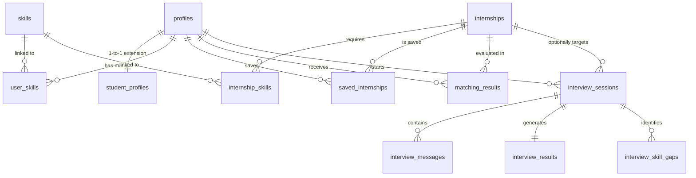

# 🌊 FitFlow | Smart Internship Matching & AI Interview Preparation System

[](https://react.dev/)
[](https://fastapi.tiangolo.com/)
[](https://supabase.com/)
[](https://openai.com/)
[](LICENSE)

---

## 📌 Executive Overview

**FitFlow** is an end-to-end, intelligent web platform designed to streamline and elevate the internship placement experience for computer science and engineering students (developed for **Universiti Teknikal Malaysia Melaka - UTeM** Final Year Project). 

FitFlow solves the common disconnect between student skill sets and industry demands by offering:
1. **Algorithmic Skill Matching:** A weighted Jaccard & domain-matching algorithm comparing student skills against real-time scraped internship offerings.
2. **Interactive Voice & Text AI Interview Prep:** A multi-turn AI interviewer powered by OpenAI (`gpt-4o-mini`) and Google Gemini (`gemini-2.0-flash`) with dynamic follow-ups, browser speech recognition, text-to-speech (TTS), and 4-axis performance radar diagnostics.
3. **Automated Resume & CV Skill Extractor:** PDF parsing and AI skill mapping to auto-populate student profiles.
4. **Company & Salary Analytics:** Real-time regional internship distribution, skill gap recommendations, and salary insights.

---

## 🏗️ System Architecture & Technology Stack

```
                               ┌────────────────────────────────────────┐
                               │           Vercel CDN (Frontend)        │
                               │        React 19 + Vite + Tailwind      │
                               └──────────────────┬─────────────────────┘
                                                  │
                                   ┌──────────────┴──────────────┐
                                   │                             │
                                   ▼                             ▼
                    ┌────────────────────────────┐  ┌────────────────────────────┐
                    │    Supabase Cloud          │  │    Render (Python API)     │
                    │ PostgreSQL + Auth + RLS    │  │  FastAPI + Uvicorn + AI    │
                    └────────────────────────────┘  └─────────────┬──────────────┘
                                                                  │
                                                    ┌─────────────┴──────────────┐
                                                    │                            │
                                                    ▼                            ▼
                                      ┌───────────────────────────┐┌───────────────────────────┐
                                      │ OpenAI API (gpt-4o-mini)  ││  Google Gemini 2.0 Flash  │
                                      └───────────────────────────┘└───────────────────────────┘
```

### Stack Breakdown

* **Frontend:**
  * **Core Framework:** React 19, Vite, JavaScript (ESNext)
  * **Styling & Aesthetics:** Vanilla CSS Design Tokens, Glassmorphism, Framer Motion animations
  * **Voice & Audio Integration:** Web Speech API (`SpeechRecognition` & `speechSynthesis`) for hands-free audio interview sessions
  * **Data Visualization:** Custom SVG Radar Charts, Metric Badges, Progress Rings
  * **Notifications:** `react-hot-toast`

* **Backend API (Python FastAPI):**
  * **Framework:** FastAPI, Uvicorn ASGI Server
  * **Security & Rate Limiting:** `slowapi` (IP-based token bucket rate limiting), CORS Regex matching
  * **PDF Parsing:** `PyPDF2` for resume text extraction
  * **Data Validation:** `Pydantic` models with strict constraints

* **Database & Authentication:**
  * **Database:** Supabase PostgreSQL with relational foreign key schemas
  * **Authentication:** Supabase Auth (JWT bearer tokens, session persistence)
  * **Security:** Row Level Security (RLS) policies protecting candidate data

* **Dual AI Failover Engine:**
  * **Primary AI Engine:** OpenAI (`gpt-4o-mini` / `gpt-4o`) via `https://api.openai.com/v1/chat/completions`
  * **Fallback AI Engine:** Google Gemini AI (`gemini-2.0-flash`, `gemini-1.5-flash`) via `google-genai` SDK

---

## 🗄️ Database Schema & Entity Relationship

The Supabase PostgreSQL database consists of 12 core tables:



### Table Definitions

| Table Name | Description | Key Fields |
| :--- | :--- | :--- |
| `profiles` | Core user identity linked to Supabase Auth | `id`, `email`, `full_name`, `avatar_url`, `role` |
| `student_profiles` | Extended candidate academic data | `id`, `phone`, `university`, `programme`, `cgpa`, `preferred_roles`, `profile_completed` |
| `internships` | Scraped and curated job postings | `id`, `title`, `company_name`, `location`, `stipend`, `job_type`, `description` |
| `skills` | Master skill library | `id`, `name`, `category` |
| `user_skills` | Junction table mapping candidate skills | `user_id`, `skill_id`, `proficiency_level` |
| `internship_skills` | Junction table mapping job requirements | `internship_id`, `skill_id`, `importance_weight` |
| `matching_results` | Precomputed match scores & recommendations | `user_id`, `internship_id`, `match_score`, `skill_overlap` |
| `interview_sessions` | Active and historical AI interview sessions | `id`, `user_id`, `internship_id`, `interview_type`, `difficulty`, `status` |
| `interview_messages` | Multi-turn interview conversation turns | `id`, `session_id`, `turn_id`, `role`, `content` |
| `interview_results` | Final diagnostic performance review | `session_id`, `overall_score`, `technical_score`, `feedback_json` |
| `interview_skill_gaps` | Identified skill deficiencies from sessions | `session_id`, `skill_name`, `recommendation` |

---

## ⚡ Core Feature Modules

### 1. 🎯 Algorithmic Skill Matching Engine
Calculates match percentages between a student's profile and available internship postings using a hybrid weighted algorithm:
$$\text{Match Score} = w_1 \cdot \text{Skill Overlap Ratio} + w_2 \cdot \text{Role Alignment} + w_3 \cdot \text{Location/Preferences}$$
* Provides instant visual feedback with color-coded compatibility scores (e.g. 95% Match).
* Displays breakdown of matched skills vs. missing skill gaps.

### 2. 🎙️ Interactive AI Interview Simulator
* **Role-Tailored First Question:** Reads target job title, company name, required skills (`React`, `Python`, `SQL`), and generates a role-specific opening scenario.
* **Dynamic Multi-Turn Follow-Ups:** Analyzes the candidate's exact previous answer and generates direct technical follow-up questions probing deeper into tools, code logic, or architecture mentioned.
* **Voice Speech Recognition & TTS:** Candidates can speak their answers directly via microphone (`SpeechRecognition`) and listen to interviewer responses via Text-to-Speech (`speechSynthesis`).
* **4-Axis Evaluation Diagnostics:** Generates overall scores, breakdown scores (Technical, Problem Solving, Communication, Role Fit), summary feedback, strengths, and targeted improvement actions.

### 3. 📄 Automated Resume / CV Skill Extractor
* Parses uploaded PDF resumes (`PyPDF2`).
* Maps raw text against skill keywords to auto-populate student profiles and preferred roles.

### 4. 📊 Location & Market Analytics
* Interactive location filtering with real-time internship counts per region (e.g. *Kuala Lumpur (42)*, *Penang (18)*, *Remote (15)*).
* Stipend range filters and category filters (Frontend, Backend, Database, DevOps, AI/ML).

---

## 🔌 API Endpoint Documentation

Base Production URL: `https://fitflow-wb01.onrender.com`

### 1. Create Interview Session
* **Endpoint:** `POST /api/interviews/session/create`
* **Headers:** `Authorization: Bearer <SUPABASE_JWT_TOKEN>`
* **Request Body:**
```json
{
  "internship_id": "c7a84e91-1234-5678-90ab-cdef12345678",
  "custom_role": null,
  "max_questions": 3,
  "interview_type": "Technical",
  "difficulty": "Medium"
}
```
* **Response (200 OK):**
```json
{
  "session_id": "a1b2c3d4-e5f6-7890-abcd-ef1234567890",
  "first_question": "Welcome Abdalla! For this Frontend Developer role at Grab, how do you manage global state and prevent unnecessary re-renders in a large React + TypeScript application?",
  "difficulty": "Medium",
  "interview_type": "Technical"
}
```

### 2. Submit Candidate Answer & Get Next Question
* **Endpoint:** `POST /api/interviews/session/{session_id}/question`
* **Headers:** `Authorization: Bearer <SUPABASE_JWT_TOKEN>`
* **Request Body:**
```json
{
  "answer": "I use React.memo and useCallback for component memoization, and Redux Toolkit to manage global state with clean slice architecture."
}
```
* **Response (200 OK):**
```json
{
  "completed": false,
  "next_question": "That is a solid approach to state management using Redux Toolkit. Can you explain a scenario where using React.memo might actually introduce performance overhead rather than optimizing it?"
}
```

### 3. Evaluate Completed Interview Session
* **Endpoint:** `POST /api/interviews/session/{session_id}/evaluate`
* **Headers:** `Authorization: Bearer <SUPABASE_JWT_TOKEN>`
* **Response (200 OK):**
```json
{
  "overall_score": 88,
  "technical_score": 90,
  "feedback_json": {
    "summary": "Demonstrated strong understanding of modern React performance patterns and state management.",
    "strengths": ["Clear explanation of Redux Toolkit", "Good awareness of memoization trade-offs"],
    "improvements": ["Elaborate more on custom hooks for reusable logic"]
  }
}
```

---

## 🛠️ Local Development & Setup

### Prerequisites
* Node.js v18+ and npm
* Python 3.10+
* Supabase Account & Project

### 1. Clone Repository & Install Dependencies
```bash
git clone https://github.com/1abdala/FitFlow.git
cd FitFlow

# Install Frontend Dependencies
npm install

# Install Backend Python Dependencies
pip install fastapi uvicorn supabase google-genai PyPDF2 slowapi python-dotenv pydantic
```

### 2. Configure Environment Variables
Create a `.env` file in the root directory:
```env
# Supabase Configuration
VITE_SUPABASE_URL=https://<YOUR_SUPABASE_PROJECT_ID>.supabase.co
VITE_SUPABASE_ANON_KEY=<YOUR_SUPABASE_ANON_KEY>
SUPABASE_URL=https://<YOUR_SUPABASE_PROJECT_ID>.supabase.co
SUPABASE_SERVICE_KEY=<YOUR_SUPABASE_SERVICE_ROLE_KEY>

# AI Engine Keys
OPENAI_API_KEY=sk-proj-...
GEMINI_API_KEY=AIzaSy...

# API Routing
VITE_API_BASE_URL=http://localhost:8000
ALLOWED_ORIGINS=http://localhost:5173,http://localhost:5174
```

### 3. Start Local Servers
```bash
# Terminal 1: Run Frontend Dev Server
npm run dev

# Terminal 2: Run Python FastAPI Backend
python -m uvicorn api.main:app --reload --port 8000
```
Open `http://localhost:5173` in your browser.

---

## 🚀 Production Deployment Architecture

| Service | Hosting Provider | Deployment Config |
| :--- | :--- | :--- |
| **Frontend Web App** | **Vercel** | `npx vite build` with SPA rewrites and security CSP headers (`vercel.json`) |
| **Backend API** | **Render.com** | Python 3 service (`uvicorn api.main:app --host 0.0.0.0 --port $PORT`) |
| **Database & Auth** | **Supabase Cloud** | PostgreSQL database with Row Level Security (RLS) policies |

### Security & Token Protection Safeguards
1. **CSP Allowed Domains (`vercel.json`):** Configured `connect-src` to allow secure HTTPS/WSS calls to Render and Supabase (`connect-src 'self' https: wss:`).
2. **CORS Middleware Regex (`api.main.py`):** Configured `allow_origin_regex=r"https://.*\.vercel\.app|http://localhost:\d+"` to allow Vercel origins.
3. **Session Question Bounds:** Hard-capped between **1 and 10 questions max** to prevent token drain.
4. **Input Length Limits:** Candidate text capped at **5,000 characters**.
5. **SlowAPI Rate Limiter:** Enforces per-IP limits (`10 sessions/min`, `20 answers/min`).

---

## 📄 License & Attribution

Developed for **Universiti Teknikal Malaysia Melaka (UTeM)** Final Year Project (FYP).
Released under the **MIT License**.
